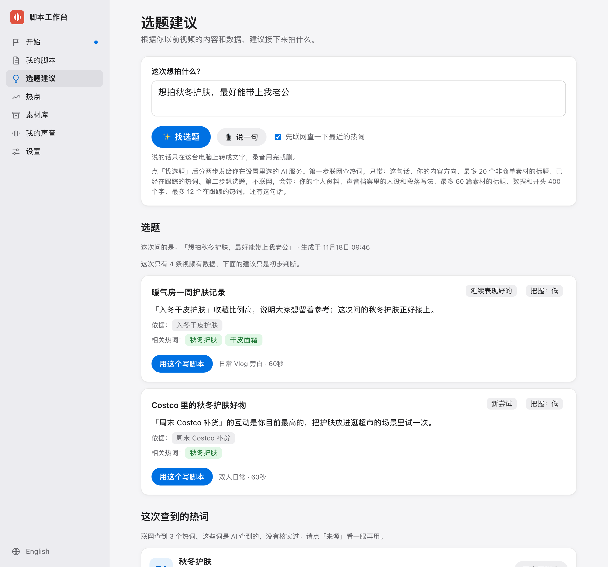

# Learn-My-Voice

**English** | [简体中文](README.zh-CN.md) · **[5-Minute Quick Start Guide](docs/QUICKSTART.md)** | **[5 分钟快速上手指南](docs/QUICKSTART.zh-CN.md)**

A local, bilingual (中文 / English) script studio for Xiaohongshu (RedNote) and other short-video creators.
It learns how one creator actually talks from her own past scripts, subtitles, and RedNote videos, drafts new scripts in that voice,
checks them, and hands the result to 剪映 (Jianying) / CapCut for editing.

It runs on your own computer. It comes in two forms: a desktop app with an installer for macOS and Windows, which needs nothing else, and a zip that needs only Python. On macOS, Python comes with Apple's free Command Line Tools, and the zip's launcher offers to install them if they are missing.


*Screenshots use invented sample data.*

## Status

This is an early version. Read this before relying on it.

| Area | State |
| :--- | :--- |
| Script editor, checks, teleprompter, library, exports | Working. Covered by automated tests and exercised in a real browser (headless Chrome, macOS). |
| AI steps (draft, learn voice, topic ideas) | Working against stand-in model replies in tests. Output quality with real models has not been evaluated yet. |
| Guided setup, voice review, lessons from edits | Covered by automated tests. Their AI parts were tested against stand-in replies, like the row above. |
| On-device transcription | A Mac with an Apple chip and macOS 14 or newer only. Set up and used on one Mac so far. Transcripts contain mistakes, especially in sentence-final particles, and wait for the creator's confirmation before their wording is learned from. |
| Trend keywords | Pasting, ranking and keyword checks work, are covered by automated tests and were exercised in headless Chrome. The ranking weights are judgement calls that have **not** been tuned against real results. Lookups by a web-searching AI have only been tested with stand-in replies. Importing a spreadsheet is new and was tested with made-up files only: no real export from 新红, 千瓜 or 灰豚, and no workbook saved by Excel, WPS or Numbers, has been tried. |
| One line to ideas | New. Typing or saying one line on 选题建议 looks current keywords up and then suggests ideas. Covered by automated tests, and the pages were run with the server in headless Chrome against stand-in AI replies. The web lookup through a Gemini or OpenAI key is written from those services' documentation and has **not** been run against either. Speaking was tested with the Whisper on one Mac and a sound stream in place of the microphone; a real microphone has **not** been tried. |
| 剪映 / CapCut | Exports standard files to import. Importing them has **not** been verified inside 剪映 or CapCut by the maintainers. It does not write 剪映 project drafts. |
| MCP server | 20 tools tested at protocol level (JSON-RPC over stdio), including viewer-comment safety bounds, commenter-name stripping, `IDEA`-only `add_video_plan` (capped at 50 waiting MCP ideas), and read-only `get_autopilot_status`. **Not** yet verified with ChatGPT, Codex or Claude Desktop. |
| Updates & version migration | Startup GitHub Releases check (at most once per 12h; switchable off in Settings or via `LEARN_MY_VOICE_NO_UPDATE_CHECK=1`), streaming `.sha256`-verified downloads, desktop OS app-data persistence, and empty-only `.zip` data migration with per-key `config.json` validation and incoming AI provider/model/key preview (`local_tools/whisper` is not copied). Tested against local stand-in transports; **not** run against live `api.github.com` in automated tests. SHA-256 checks download integrity against the published `.sha256` file, not release authenticity, and installers remain unsigned. |
| Numbers, Creator Center import & comments | Time-series `metric_snapshots` (`views/day`), two-step preview-then-import for `.csv`/`.tsv`/`.txt`/`.xlsx` tables, negation-aware comment word-list counts, XML-fenced Stage 9 AI comment summaries, and screenshot comment OCR preview. Tested with synthetic tables and stand-in replies: **no** real Xiaohongshu Creator Center export has been seen or tried, and vision/summary AI calls were **not** run against live cloud endpoints. |
| Video planner (`#/plan`) | List, week, and month calendar views, inline editing, batch planning from viewer questions and saved ideas, non-destructive Autopilot keyword suggestion chips (Take / Dismiss), and plan-linked script creation (AI, copy & paste, or empty). Covered by automated tests and headless Chrome (`zh`/light and `en`/dark). No test presses a key, so use by keyboard alone is **not** shown. |
| Voice, tone counts & sound stats | Counted wording habits with per-script reference ranges on `#/voice` and beside Voice Match in the editor, plus pauses per 100 spoken units, loudness range (dB), and autocorrelation voice pitch median/span measured from extracted 16 kHz WAVs during transcription. Verified on synthetic WAVs and macOS `say`, **not** on real Xiaohongshu voiceover recordings or against external tools such as Praat. |
| Sponsored briefs (`#/sponsored`) | `.txt`/`.md`/`.docx` brand brief ingestion (PDFs and `.doc` refused), bilingual plain digest, grounded requirement verification, story angles, `SPONSORED` drafting (raw brief never enters Stage 4), live editor requirement/word-list checklist, and `PRAGMA secure_delete` scrubbing on deletion. Tested with synthetic `.docx` files and stand-in replies, **not** with real agency briefs or live models. |
| Anthropic Claude & Beat bank | Anthropic Messages client (`provider="anthropic"`), stop-reason truncation/refusal guards across Gemini, OpenAI, Anthropic, and local models (`llm.PROVIDER_STOP_REASON_UNCHECKED`), centralized per-stage temperatures with HTTP 400 retry-once fallback, and Stage 1B `sample_beats` stored on Library items, surfaced in editor References, and fed into `<creator_beat_examples>` using only confirmed non-sponsored `spoken_text` and enum labels (no model prose, no `LIVE_CLIP`). The Anthropic client (`llm.ANTHROPIC_UNCHECKED`) and provider stop-reason payloads were written from documentation and tested against stand-in responses, **never** against live cloud APIs. |
| Autopilot (`#/autopilot`) | Optional background learning and trend adaptation (switched off by default; disabled under `LEARN_MY_VOICE_NO_AUTOPILOT=1`) with `suggest` and bounded `auto` modes, a daily model-call cap, watched-folder video/audio & spreadsheet intake (`voice.ingest_folder`, `sponsored/` and `商单/` marked `is_sponsored`), continuous Voice DNA updates (`voice.relearn`) and recurring edit-lesson acceptance (`lessons.accept_recurring`), scheduled AI trend lookup and polite `robots.txt`-checked public `https://` page extraction (`trends.refresh`, `xiaohongshu.com`/`rednote.com` refused), non-destructive plan keyword chips (`plans.suggest`) and candidate topic refreshes (`ideas.refresh`), and per-run **Undo**. Covered by automated unit tests and headless Chrome (`zh`/light and `en`/dark) against stand-in transports; **not** yet run unattended over days against live cloud APIs or real public trend sites. |
| Platforms | Developed on macOS with Python 3.9. Nobody has used it on Windows or Linux yet. The automated tests run on all three systems on GitHub's machines with Python 3.9, 3.14 and 3.15; as of November 2026 they pass on all three, and the zip starts with its launcher on all three. Each release candidate's notes say what was found for that build, per system. |
| Desktop app | New. Installers for macOS (Apple chip and Intel chip) and 64-bit Windows are built on GitHub's machines, where each one is installed and the app is opened, used and ended before it is attached to a release candidate. **No person has installed one yet.** The installers are not signed, so the system has to be told once that the app may run. Transcribing videos in the desktop app needs a Mac with an Apple chip and Apple's free Command Line Tools; that was tried on one Mac with the app started from its source, **not** inside the desktop app. A microphone has not been tried in it, and there is no build for Linux. Before an installer is attached, the page in the installed app's own window has to open a script, export it, follow a link and delete the script by itself; what each trial found is attached to the release candidate as `desktop-<system>-trial.txt`. |

## Quick start

> **New here?** Start with the step-by-step **[Quick Start Guide](docs/QUICKSTART.md)** ([简体中文](docs/QUICKSTART.zh-CN.md)) for screenshots and a 5-minute walkthrough from first launch to CapCut / 剪映 export.

Release candidates are on the repository's
[Releases page](https://github.com/LetsLearntocodeforfun/Learn-My-Voice/releases). Each offers the app in two forms.

**As a desktop app.** Nothing else is needed: Python is inside it. Download the installer for your system:

| System | File | The first time |
| :--- | :--- | :--- |
| macOS, Apple chip | `learn-my-voice-<version>-macos-arm64.dmg` | Open the `.dmg` and drag Learn My Voice to Applications. Open it; macOS refuses. Then open System Settings, go to Privacy & Security, scroll down and click Open Anyway. |
| macOS, Intel chip | `learn-my-voice-<version>-macos-x64.dmg` | The same. |
| Windows, 64-bit | `learn-my-voice-<version>-windows-x64-setup.exe` | Run it. When "Windows protected your PC" appears, click More info, then Run anyway. |

The system objects because the installers are not signed: this project has no paid certificates. This is needed once. On a computer managed by an employer or a school it may not be allowed at all; the zip below, which runs with a Python the system already has, may still work there. Which chip a Mac has is shown under the Apple menu, About This Mac. The app opens in a window of its own. What it keeps (scripts, library, settings) is in the system's folder for application data, so installing a newer version keeps it. An export goes into your Downloads folder and the app says where it went; a link to another site opens in your browser. To transcribe videos, the desktop app needs a Mac with an Apple chip and Apple's free Command Line Tools, and says how to get them. No person has installed it yet: the notes of each release candidate say what GitHub's machines found when they installed and used that build.

**As a zip.** Requirements: Python 3.9 or newer. No packages to install. Download
`learn-my-voice-<version>.zip`, unpack it, and start it:

| System | Start it with |
| :--- | :--- |
| macOS | double-click `启动工作台.command` or `Start Learn My Voice.command`. macOS refuses to open it the first time: on macOS 15 or newer, open System Settings, go to Privacy & Security and click Open Anyway; on older versions, right-click the file and choose Open. |
| Windows | double-click `Start Learn My Voice.bat` |
| Linux | `sh start-learn-my-voice.sh` in a terminal |

The Windows and Linux launchers are new, and no person has used them yet. The notes of each release candidate
say whether that build started on each system on GitHub's machines, and give the SHA-256 of the zip. When you unpack a newer `.zip` alongside an older one, **Settings → Version & Updates** can copy your earlier `data/` (settings, sealed API keys, Voice DNA, scripts, library, plans) into a freshly unpacked empty folder (`local_tools/whisper` is not copied and must be set up again if used).

**From the source.**

```bash
git clone https://github.com/LetsLearntocodeforfun/Learn-My-Voice.git
cd Learn-My-Voice
python3 -m studio.server
```

From the zip or the source, each start creates a fresh local access token and opens the studio in your browser (`http://127.0.0.1:8765/?token=...`, also printed as a launch link in the terminal window). Start it from the launcher rather than bookmarking the bare address. Settings shows which build is running.

The interface starts in Chinese. Use the **English** button at the bottom of the sidebar to switch.
It follows your computer's light or dark appearance; **Settings → Appearance** has light, dark and a choice of
accent colour. The language and the look are remembered, also the next time the desktop app is opened.

## First 10 minutes

1. **开始 / Start** opens the first time. Step 1: the creator's name, what they make, and phrases they never use.
2. Step 2: add material. Scripts written by hand (`.txt`, `.md`, `.docx`), subtitle files (`.srt`, `.vtt`), or videos on a Mac with an Apple chip. At least 3 non-sponsored items; 5 or more is better.
3. Step 3: choose how AI is provided (see the next section; the default needs no key) and have it propose a voice profile. Each item of the proposal is checked against the material. Decide item by item, then accept it.
4. Step 4: draft a first script (or translate a brand brief first via **商单 Brief / Sponsored brief** on the new-script page). Under it the app lists which material the draft was based on.
5. **素材库 / Library**: type in views, likes, collects and comments, preview and import a Creator Center spreadsheet, or paste viewer comments (commenter nicknames are stripped and never stored) to count questions/themes or summarize with AI; tick 商单 for sponsored items.
6. **热点 / Trends** (optional): paste keywords you see trending on Xiaohongshu to have them ranked against your own results.
7. **选题建议 / Ideas**, **拍摄计划 / Plan** & **自动学习 / Autopilot** (optional): generate evidence-backed topic ideas, batch-add viewer questions or saved ideas to your upcoming video calendar (list, week, or month view), turn any planned item into a linked script, and optionally switch on **Autopilot** (`#/autopilot`) to watch a folder of videos/spreadsheets, adapt Voice DNA, refresh public trends, and suggest keywords for upcoming plans in the background.
8. **我的脚本 / Scripts**: edit the draft alongside Voice Match, Tone Habits, References (with matching video beats), and Sponsored Checklist, read it with the teleprompter, and export the 剪映 kit.
9. Once the video is out: on the script, click **标记为已发布 / Mark as posted**, and type in or import numbers over time (`views/day`). The script joins the library with its numbers and advances any linked plan to `POSTED`.

Until a voice profile has been accepted the app uses a bundled *example* voice profile for a fictional creator, and says so on screen.

## Ways to provide the AI

| Option | What you need | Where her text goes |
| :--- | :--- | :--- |
| **ChatGPT subscription (copy & paste)**, the default | A ChatGPT account, or any chat AI. No API key. | The chat you paste into |
| **MCP** | An AI app that supports MCP (see below) | That app's provider |
| **Google Gemini**, **OpenAI**, or **Anthropic Claude** API | An API key | Google, OpenAI, or Anthropic |
| **Local model** | Ollama or LM Studio running on the same computer | Nowhere; it stays local |

### Copy & paste with a subscription

A ChatGPT subscription does not include API access, so the studio cannot call it directly. In this mode,
each AI step shows a prepared prompt. Paste it into ChatGPT, then either **choose / drag-and-drop a `.json` file** that ChatGPT generated or **paste the reply text** back (extra prose around code blocks, trailing commas, comments, and smart quotes are tolerated; on Step 3 and Voice you can also import a saved JSON reply directly if the dialog was closed).
The prompt contains her voice profile and the relevant script text.

Looking up trend keywords works this way when not using Gemini/OpenAI's built-in lookup, because it needs an AI that can
search the web at that moment. That prompt contains her video titles rather than script text.


### Local models

Start Ollama or LM Studio, download a model, then choose **本地模型 / Local model** in Settings.
The studio lists whatever models are installed. Only addresses on the same computer are accepted.
Check your runtime's context-window setting: the prompts are long (often over 10,000 characters) and a small default window will cut them off.

### MCP server

`run_mcp.py` is a Model Context Protocol server over stdio. With it, an AI app does the writing while this
tool supplies her voice, her past scripts, the checks and the storage. Scripts saved through MCP appear in the studio.

Tools (20): `get_script_brief`, `save_script`, `update_script`, `check_script`, `list_scripts`, `get_script`,
`get_voice_profile`, `list_library`, `get_voice_learning_brief`, `save_voice_profile`,
`get_topic_ideas_brief`, `save_topic_ideas`, `export_jianying_kit`, `list_trends`, `add_trend_keywords`,
`get_rednote_analytics`, `get_tone_analysis`, `list_video_plans`, `add_video_plan`, `get_autopilot_status`.

The setups below follow each vendor's documentation as of November 2026. None has been verified by the maintainers yet.
Use an absolute path; a path without spaces avoids quoting problems.

The Settings page shows the Codex configuration with the real paths of the app that is running: its Python, its
`run_mcp.py`, and after `--data-dir` the data folder it is using. Copy the paths from there. For the desktop app
this matters: its Python and its script are inside the app, and its data is in the system's folder for
application data, which `--data-dir` names. Without `--data-dir` the server uses the `data` folder next to
`run_mcp.py`, which is right for the zip and for a copy of the source.

**Codex (signed in with a ChatGPT plan)**: add to `~/.codex/config.toml`:

```toml
[mcp_servers.learn_my_voice]
command = "python3"
args = ["/absolute/path/to/Learn-My-Voice/run_mcp.py"]
```

The Settings page shows this snippet with the real paths filled in.

**ChatGPT on the web**: ChatGPT can add a custom MCP server, but it must be reachable over HTTP or through
OpenAI's Secure MCP Tunnel; it cannot start a local program by itself. The tunnel client can launch this server:

```bash
tunnel-client init --sample sample_mcp_stdio_local --profile learn-my-voice \
  --tunnel-id <your tunnel id> \
  --mcp-command "python3 /absolute/path/to/Learn-My-Voice/run_mcp.py"
tunnel-client run --profile learn-my-voice
```

OpenAI's guide says the tunnel needs a tunnel id and an API key from the OpenAI Platform for the tunnel itself.
See [Add custom MCP server](https://developers.openai.com/api/docs/guides/custom-mcp-server) and
[Secure MCP Tunnel](https://developers.openai.com/api/docs/guides/secure-mcp-tunnels).

**Claude Desktop and other stdio clients**:

```json
{ "mcpServers": { "learn-my-voice": { "command": "python3", "args": ["/absolute/path/to/Learn-My-Voice/run_mcp.py"] } } }
```

Then ask in chat, for example: *"Use Learn My Voice to write a 60-second script about our weekend Costco run."*

## What it does

- **Script editor**: one card per spoken line, with shot and on-screen text (花字) fields, live character count and read time, autosave.
- **Live checks**, in Chinese and English: lines too long for one breath, phrases she never uses, influencer clichés, translated-sounding Chinese, risky advertising wording, and total length against the target duration. These are rules, not AI, so they are instant and repeatable.
- **Guided setup** (开始 / Start): five steps: who the creator is, their material, their voice, a first script, and what keeps learning afterwards. Each step says what leaves the computer and what does not.
- **Material & visual RedNote video ingestion**: scripts written by hand (`.txt`, `.md`, `.docx`), subtitle files (`.srt`, `.vtt`), and video/audio files (`.mp4`, `.mov`, `.m4a`, `.mp3`, `.wav`) on both Start and Library, with inline video preview and visual keyframes. Videos can be transcribed offline on an Apple-chip Mac, analyzed for speech + tone + `花字` via Gemini, transcribed via OpenAI, or ingested with zero API key via ChatGPT/Gemini copy-paste. Subtitle files and videos carry timestamps, so speaking rate is measured from them.
- **Voice learning**: an AI reads the material and proposes a voice profile. Code then looks up every phrase the proposal attributes to the creator in that material. The review shows what was found, what was not, what the AI wanted to ban although the creator says it, and all 21 descriptive Voice DNA fields (with notes linked to the entries they describe). Nothing takes effect until the creator accepts the proposal. Breath-length limits are measured in code once there are 30 breaths of material. Sponsored scripts are kept out of the core profile. Earlier profiles are kept and can be restored.
- **References & Beat Bank beside the editor** (参考 / References): while editing a script, open the side panel to see items pinned to that script, which items and beats the AI draft's prompt saw, related library items on the same topic, matching Stage 1B video beats (`HOOK`, `COUPLE_BANTER`, `PRODUCT_EXPERIENCE`, `REALISTIC_CAVEAT`, etc.) from confirmed non-sponsored videos, and a full-text search of the library — all computed locally in code without calling an AI.
- **Voice & tone habits + sound measurements**: on **我的声音 / Voice** and in a collapsible panel beside Voice Match in the editor, the studio counts particles, spoken vs. formal connectors, reduplicated words, hedges/caveats, hard-sell phrases, questions and exclamations per breath alongside per-script reference ranges from confirmed non-sponsored material, plus speaking pace, pauses per 100 spoken units, loudness range (dB), and autocorrelation voice pitch median/span measured from extracted 16 kHz WAVs during transcription.
- **Line tools & structured AI read-through**: per-line **Openings**, **Reword**, and **Shorten** proposals plus a script-wide **AI read-through** critic pass with structured, inspectable reasons. Every proposal runs through the deterministic rule checks first and waits for **Use this** (with Undo).
- **Sponsored briefs & editor checklist** (新建脚本 → 商单 Brief / Sponsored brief): paste a brand collaboration brief or upload `.txt`, `.md`, or `.docx` (PDFs and `.doc` are refused). After disclosing which AI service will read the brief, Stage 3 translates it into a bilingual plain digest, everyday selling points, code-grounded requirements (any quote not found in the brief starts switched off), word-list flags, and story integration angles. Picking an angle drafts a `SPONSORED` script whose Stage 4 prompt receives only your accepted plan (never the raw brief), attaches a live requirement/compliance checklist beside the editor, forces `is_sponsored` when marked as posted so brand wording stays out of Voice DNA, and overwrites the brief's bytes via `PRAGMA secure_delete = ON` if deleted.
- **Drafting**: every draft is anchored on her own best-performing scripts and confirmed non-sponsored video beats as examples. A script can have up to 8 target keywords; her past scripts on those topics are then used as the examples first, and the editor shows whether each keyword ended up in the spoken lines or in the drafted title options, caption or hashtags. The title options, cover text, caption and hashtags that the AI drafts with a script are shown under it, to read and copy.
- **Lessons from edits**: each AI draft lists which of the creator's scripts its prompt contained. The app shows what the creator then changed in the draft, counting wording only, and a change can be remembered (non-sponsored scripts only). Remembered changes go into later draft prompts, and a phrase removed in more than one script is offered for the never-say list.
- **Numbers by day, Creator Center table import & viewer comments** (素材库 / Library): record views, likes, collects and comments over time (`metric_snapshots` and `views/day`, with an optional posted date on items added by hand), or preview and import a Creator Center `.csv`, `.tsv`, `.txt`, or `.xlsx` spreadsheet matched by exact title (with optional shares, new followers, cover click rate, average watch time, and completion rate). Paste viewer comments—or extract comment lines into the paste box from screenshots via copy & paste or a privacy-confirmed vision AI call—with commenter nicknames stripped and never stored; count questions, praise, and complaints locally with negation-aware word lists (`not_judged`), or summarize via an XML-fenced Stage 9 AI prompt.
- **Topic ideas & Upcoming Video Planner** (选题建议 / Ideas & 拍摄计划 / Plan): Stage 6 ranks past videos, incorporates viewer comment summaries/questions and unposted plans so topics are not duplicated, and verifies cited titles and patterns. On `#/plan`, view upcoming videos as a list, week calendar, or month calendar, edit titles/notes/dates/durations/formats in place, batch-add viewer questions or saved ideas in one step, and turn any plan into a linked script via Settings AI, copy & paste, or an empty script.
- **One line to ideas**: on 选题建议, and on the home page once an AI is connected, type one line about what you want to film, or say it on a Mac that has the on-device transcriber. With a Gemini or OpenAI key the app first asks that service to search the web for current keywords in the creator's niches, keeps the ones that come with a source link, marked as unverified, and then asks for ideas that answer the line. With a local model or in copy & paste mode the same two steps are offered by hand. The page shows the ideas, the keywords found with their sources, and the pages the lookup cited. When one step fails the other's result is still shown, and ideas saved earlier stay.
- **Trend keywords** (热点): paste keywords you see trending, with an optional heat number, or import a keyword list saved from an analytics tool as `.csv`, `.tsv`, `.txt` or `.xlsx`. For a file, the studio shows which columns it took for the keywords and for the number and how the first rows read; you can change the columns, and nothing is stored until you click Import. The studio ranks the keywords by how hot and recent they are and by how her own videos on that topic performed. You choose how much each side counts. The ranking is arithmetic, not AI. Keywords that clash with her voice profile are marked and left out of suggestions. A web-searching chat AI can also look keywords up through the copy & paste dialog or MCP; those need a source link and are labelled as unverified.
- **Teleprompter**: full screen, adjustable speed and size.
- **Mark as posted**: a script written in the studio that was filmed and posted becomes one library item, with the day it was posted, an optional link (kept as text, never opened) and its numbers. The numbers count at once wherever her own results are used. The day the numbers were read is kept beside them and shown as days after posting; nothing is adjusted or projected. The wording does not count as hers until she confirms it, or attaches the video's subtitle file or a transcript, because the text may have begun as an AI's draft. The page says how many lines are still exactly as the AI wrote them, counted in code. An opening that is still the AI's sentence is never listed among her own openings.
- **Word list** (设置 / Settings): the checks flag advertising wording that may be a problem, and each finding says what its entry rests on: an article of the Advertising Law that was read, or that no source was checked. A separate kind of finding, labelled "hint only", marks wording that may sound written rather than spoken; it is never counted as a problem. Any entry can be switched off, and you can add phrases of your own. The list is this project's own: it is not legal advice and not a statement of Xiaohongshu's rules, and a script with no finding is not thereby allowed.
- **Autopilot background learning & trend adaptation** (自动学习 / Autopilot `#/autopilot`): optional background scheduler (off by default) with **Suggest only** (`suggest`) and bounded **Auto** (`auto`) modes, a daily model-call cap, per-task toggles, **Run now**, and per-run **Undo**. Once configured, it watches a local folder (read-only, 60-second settle check) to ingest videos/audio (`local` offline Whisper or opt-in `cloud` Gemini/OpenAI, with `sponsored/` and `商单/` tagged `is_sponsored`) and `.csv`/`.tsv`/`.xlsx` keyword spreadsheets, continuously proposes or safely applies Voice DNA updates (`voice.relearn`) and recurring edit lessons (`lessons.accept_recurring`), refreshes trends from scheduled AI web search and up to 5 polite `robots.txt`-checked public `https://` pages (`trends.refresh`), attaches non-destructive keyword suggestion chips to upcoming plans on `#/plan` (`plans.suggest`), and stages candidate topic refreshes on `#/ideas` (`ideas.refresh`).
- **Updates & cross-version data** (设置 / Settings): checks GitHub Releases at most once per 12 hours on startup (switchable off in Settings), shows a startup notice when a newer version exists (Download, What's new, Later, Skip this version), streams exact release assets while verifying their published `.sha256` sidecar, keeps desktop app data in the OS application-data folder across installs, and lets portable `.zip` builds unpack a verified update into a new sibling folder or migrate an earlier folder's `data/` (with per-key `config.json` validation and incoming AI provider/model/key preview) into an empty folder inside `Backups`'s safety gate.
- **Backup and restore** (设置 / Settings): packs scripts, library items, video beats, metric snapshots, cleaned viewer comments and summaries, plans, plan keyword suggestions, candidate idea sets, Autopilot run history, sponsored briefs, the creator profile, the active and earlier voice profiles, tracked keywords and sightings, remembered edits, and word-list changes into one portable backup file (`DATA_VERSION = 4`; API keys are never included). Restoring previews the archive first and saves an automatic backup of current data so a restore can be undone.
- **Exports**: 剪映 / CapCut kit, subtitle `.srt`, voiceover text, shot list, on-screen text list, standalone `.html` teleprompter.



## 剪映 (Jianying) / CapCut

From a script, **导出 → 剪映素材包** downloads a zip:

| File | Use |
| :--- | :--- |
| `口播文稿.txt` | One breath per line. Paste into 剪映's 文稿匹配 (script matching) to get subtitles aligned to the real recording. |
| `字幕.srt` | Subtitle file to import. **Timing is estimated** from her speaking rate, not taken from a recording, so it needs adjusting. |
| `花字.srt` | On-screen text placed near the line it belongs to. |
| `拍摄清单.txt` | What to film for each line. |
| `使用说明.txt` | Import steps. |

Switch the app to English before exporting to get English file names and instructions.


What it does not do yet: write a 剪映 project draft with clips and text already on the timeline, or time subtitles
from her actual audio. The draft format is undocumented and unreadable in recent versions, and the main open-source
generator reports limits for drafts produced on macOS, so this needs testing against a real installation first.

## Data and privacy

- Everything is stored in `data/` inside the project folder (or in your OS application-data folder for the desktop app): scripts, library, beats, metric snapshots, comments, plans, Autopilot runs/sightings/suggestions, sponsored briefs, the creator profile from setup, voice profile, settings. The folder is git-ignored, and on macOS and Linux it is closed to the other accounts on the computer.
- API keys are encrypted at rest via `studio/keystore.py` (Windows DPAPI or a `0600` key in your OS application-config folder on macOS/Linux) rather than stored in plaintext in `data/config.json`, and are never sent back to the browser or included in backups. If `data/` is moved to another machine, sealed keys are preserved untouched until you enter a key on that machine.
- The web server listens on `127.0.0.1` only, requires a per-launch local capability token and port-scoped session cookie, checks `Host` and `Sec-Fetch-Site` headers, and refuses requests from other websites. See [docs/SECURITY_NOTES.md](docs/SECURITY_NOTES.md) for details.
- AI steps send the creator profile, her voice profile, her notes and parts of her past non-sponsored scripts/beats to whichever AI you chose. With a local model nothing leaves the computer.
- Brand briefs added under **Sponsored brief** are kept in `studio.db` (and included in backups while kept); deleting a brief overwrites its bytes via `PRAGMA secure_delete = ON`. Reading a brief sends the brief text, creator profile, and Voice DNA (never past scripts) to the AI service named on screen; Stage 4 drafting sends only your accepted `Sponsored Plan` (never the raw brief).
- A video added for transcription (or copied temporarily from your **Autopilot** watched folder when `transcribe_route == "local"`) is copied into `data/uploads/` and transcribed on this Mac; your original watched-folder files are never modified, renamed, or deleted. Only if you explicitly choose `transcribe_route == "cloud"` on `#/autopilot` are settled watched-folder videos/audio uploaded to your configured Gemini or OpenAI account within your daily model-call cap. Loudness range, pauses, and pitch are measured locally from the temporary 16 kHz WAV before deletion. The copy and temporary WAV are deleted when transcription ends, whatever the outcome; only text, timing, and sound numbers are kept. The programs that transcribe locally are started under macOS rules that deny them the network, and where those rules cannot be set up nothing is transcribed.
- Setting up transcription downloads software from pypi.org and one speech model from huggingface.co, about 2 GB in all, into `local_tools/whisper/` inside the project folder. Nothing about the creator is sent.
- **Nothing is fetched from Xiaohongshu (`xiaohongshu.com`, `rednote.com`, `xhslink.com`) or any social platform login.** Views, likes, collects and comments are typed in, imported locally with a preview from a spreadsheet you choose, or pasted (leading commenter nicknames are stripped and never stored; MCP tools also strip commenter names and warn connected AI apps that comments are untrusted viewer text). Optional **Autopilot** (`#/autopilot`, off by default) fetches only public `https://` trend pages you explicitly list, after verifying global public IPs (pinned against DNS rebinding) and `robots.txt` permission (`Learn-My-Voice-Autopilot`), stripping scripts/markup, and XML-fencing page text before Stage 10 keyword extraction. Extracting comments from screenshots via a configured vision AI sends the image(s) only after you confirm a warning that screenshots show other people's nicknames and avatars, and places the text in the paste box rather than saving automatically. Stage 9 AI comment summaries send only that video's title, four counts, and cleaned comment texts.
- When started normally by a person with startup update checks enabled (default on; switchable off in **Settings** or via `LEARN_MY_VOICE_NO_UPDATE_CHECK=1`), the app sends a `GET` request at most once every 12 hours to `api.github.com` for this repository's release list (no creator data is sent, though GitHub sees your IP address and timestamp).
- Trend keywords are pasted in by hand, imported from a file you choose (or dropped into your Autopilot watched folder when `keyword_files` is on), extracted from a public `https://` page you configured in Autopilot, or looked up by a web-searching AI. An imported file goes to this app on `127.0.0.1`, is read there and is not kept; no AI is involved. A trend lookup prompt contains the niches from the creator profile, the titles of up to 20 non-sponsored videos, the line you typed or said and the keywords already tracked. It does not contain script text, the creator's name or anything from the voice profile. The ideas prompt that follows is a separate request, sent without web search.
- A spoken line is recorded in the browser, sent to this app on `127.0.0.1`, turned into text by the on-device transcriber and deleted. The browser's own speech recognition is not used. The text appears in the box first; nothing goes to an AI until 找选题 is clicked.

## Project layout

| Path | Contents |
| :--- | :--- |
| `studio/server.py`, `studio/web/` | Local web server and the interface |
| `studio/guardrails.py`, `studio/lexicon.json`, `studio/checks.py` | Rule-based checks and their bilingual messages |
| `studio/pipeline.py`, `studio/llm.py` | Prompt building, reply validation, model providers (Gemini, OpenAI, Anthropic, local, copy & paste), stage temperatures |
| `studio/corpus.py` | Reading her scripts, measured statistics, performance ranking |
| `studio/creator.py`, `studio/setup.py` | The creator profile from setup, and where setup stands |
| `studio/evidence.py` | Looks up what a proposed voice profile claims in the creator's own material |
| `studio/refs.py`, `studio/web/refs.js` | References panel & Stage 1B Beat Bank beside the script editor |
| `studio/sponsored.py`, `studio/web/sponsored.js` | Stage 3 brand brief translation, grounded requirement checks, `SPONSORED` drafting, editor checklist |
| `studio/rednote_analytics.py`, `studio/web/rednote.js` | Time-series metric snapshots, Creator Center table preview/import, comment counting, Stage 9 summaries, screenshot OCR |
| `studio/planner.py`, `studio/web/planner.js` | Upcoming video planner (`#/plan`), week/month calendar views, batch planning, plan-to-script linking |
| `studio/autopilot.py`, `studio/autovoice.py`, `studio/trend_sources.py`, `studio/autosuggest.py`, `studio/web/autopilot.js` | Background Autopilot scheduler, watched-folder voice/keyword intake, polite public trend sources, plan/idea suggestions, and Undo |
| `studio/soundstats.py`, `studio/tone_analyzer.py`, `studio/web/tone.js` | 16 kHz WAV loudness/pause/pitch measurement and counted wording/tone habits |
| `studio/updater.py`, `studio/web/updater.js` | GitHub Releases checker, streaming `.sha256` downloader, and empty-only `.zip` data migration |
| `studio/keystore.py`, `studio/backup.py` | OS-backed API key sealing, Windows `data/` ACL restriction, and `.lmvbackup` archive staging/restore |
| `docs/QUICKSTART.md`, `docs/QUICKSTART.zh-CN.md` | Bilingual 5-minute Quick Start Guide with screenshots |
| `studio/learning.py` | Compares an AI draft with the creator's version |
| `studio/timing.py` | Subtitle files, and speaking rate measured from their timestamps |
| `studio/transcribe.py`, `studio/whisper_worker.py`, `studio/jobs.py` | On-device transcription and its background jobs |
| `studio/trends.py` | Reading pasted trend keywords, sightings/rising marks, scoring against her own results, keyword coverage |
| `studio/keyword_import.py` | Bounded table reader (`.csv`, `.tsv`, `.txt`, `.xlsx`) shared by keyword and Creator Center imports |
| `studio/exports.py` | Text exports, `.srt`, 剪映 kit |
| `studio/mcp_server.py`, `run_mcp.py` | MCP server (20 tools) |
| `studio/buildinfo.py` | Which build is running: the version from a release package, or "from source" |
| `prompts/` | The prompt blueprints (`01`–`10`); editing `02`–`10` changes runtime behaviour. |
| `.github/workflows/tests.yml` | Runs the tests on macOS, Windows and Linux on every push |
| `.github/workflows/release-candidate.yml` | On a push to a `beta/...` branch: tests, builds the zip and desktop installers, tries them, publishes a pre-release |
| `tools/build_release.py`, `tools/try_release.py`, `tools/run_tests.py` | What those workflows run; they run the same on a desk. Not part of the download. |
| `SYSTEM_DESIGN.md` | The original, larger design. Parts of it are not built. |

The prompts receive the creator profile from setup (name, niches, an on-camera partner, phrases never
to be used) and no longer assume one particular creator. They are written for Xiaohongshu video scripts in Chinese.

## Development

```bash
python3 -m unittest discover -t . -s tests        # all tests, no dependencies
python3 tools/build_release.py build              # the zip a release would hold, from the last commit, into dist/
python3 tools/try_release.py dist/learn-my-voice-*.zip    # unpack it, start it with its launcher, use it, stop it
python3 -m studio.guardrails tests/fixtures/worked_example_script.json --dna schemas/voice_dna.example.json
```

## Known limits

- The advertising-rule, tone-habit, and comment-sentiment word lists are starting points collected for this project. They have not been checked against current platform or legal rules, are not legal advice, and count surface wording rather than judging quality or meaning.
- Speaking rate cannot be learned from text. It is measured once the library holds at least a minute of timed material (subtitle files or transcribed videos). Until then it is a default, or the number the creator types in. Sound measurements (loudness range, pauses, autocorrelation pitch estimate) cannot separate background music, street noise, or a second speaker from the creator's voice, and cap at the first 10 minutes of audio.
- On-device transcription only runs on a Mac with an Apple chip, macOS 14 or newer, and the Python that comes with Apple's Command Line Tools (3.9). It has been set up and used on one Mac so far. Whisper gets some sentence-final particles wrong: in testing on synthetic speech it wrote 嘛 as 吗, 呗 as 背, 喔 as 哦 and 呐 as 呢. So by default a transcript (and any Stage 1B video beats) waits for the creator's confirmation before its wording is learned from; if you switch Autopilot to `auto`, non-sponsored transcripts that pass deterministic length, CJK-ratio, and speaking-rate checks are auto-confirmed (and reversible via **Undo**), though homophone particle errors can still slip past surface checks.
- With only a few videos that have numbers, topic suggestions are weak. The app says so.
- Trend scores and performance buckets in `#/library` / `#/plan` are guides, not calibrated measurements: thresholds and weights have not been tuned against real outcomes.
- Importing a keyword or Creator Center spreadsheet reads the first sheet of a workbook, at most 5,000 rows and 50 columns. Header names recognized for Creator Center tables (including shares, new followers, cover click rate, average watch time, and completion rate) are guesses made without having seen a real Xiaohongshu Creator Center export, so always inspect the column preview before importing. Old `.xls` files, PDFs, legacy `.doc` files, and password-protected workbooks are refused.
- Keywords found by an AI or extracted from a configured public `https://` trend page stay marked as unverified (`ai_lookup`, `web_page`, `file`) unless you enter them yourself. Autopilot's public-page fetcher reads static HTML/text only (no JavaScript rendering, no login cookies) and refuses any site whose `robots.txt` disallows it, including `xiaohongshu.com` and `rednote.com`.
- The web lookup built into 选题建议 and Autopilot is written from Google's and OpenAI's documentation as it read on 16 November 2026 and has not been run against either service. Likewise, the Anthropic Claude Messages client (`studio/llm.py`, `llm.ANTHROPIC_UNCHECKED`) and provider stop-reason truncation/refusal checks (`llm.PROVIDER_STOP_REASON_UNCHECKED`) were written from documentation and tested against stand-in responses, never against live cloud APIs, and multimodal screenshot comment OCR has only been tested against stand-in transports.
- Downloads triggered from the update banner verify the file against the `.sha256` sidecar published on GitHub Releases: this proves the download arrived whole and matches what was published, not that a release was signed by a trusted certificate authority (installers remain unsigned). Portable `.zip` version migration never copies the ~2 GB `local_tools/whisper` folder; if you use on-device transcription from a `.zip`, set it up again in the new folder.
- Speaking a line needs the on-device transcriber, so it works only where video transcription does. Whisper mishears: in a test with a synthetic Chinese voice it wrote 秋冬 as 邱中. The text is shown in the box to be corrected before anything is sent.
- An automatic cold-session second-pass critic after every draft (`SYSTEM_DESIGN.md` Stage 5A) is not run automatically; the creator triggers **AI read-through** in the editor when wanted.

## License

MIT. See [LICENSE](LICENSE).
