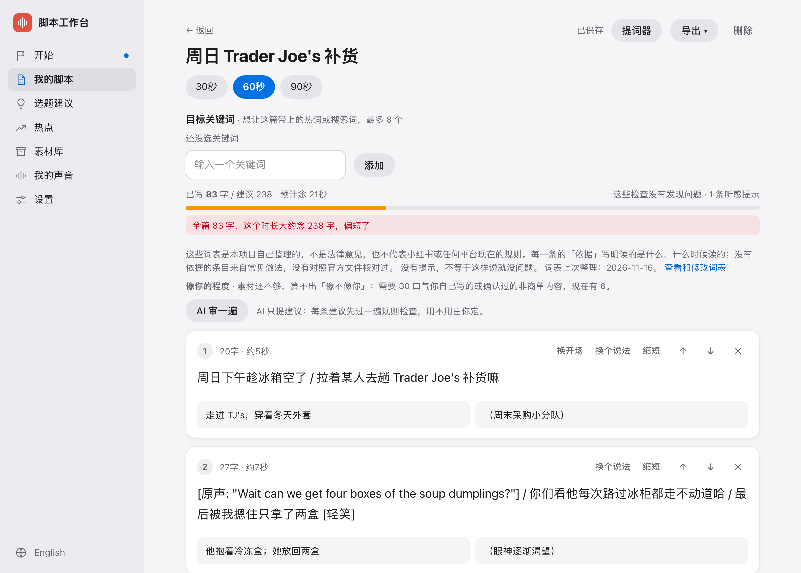
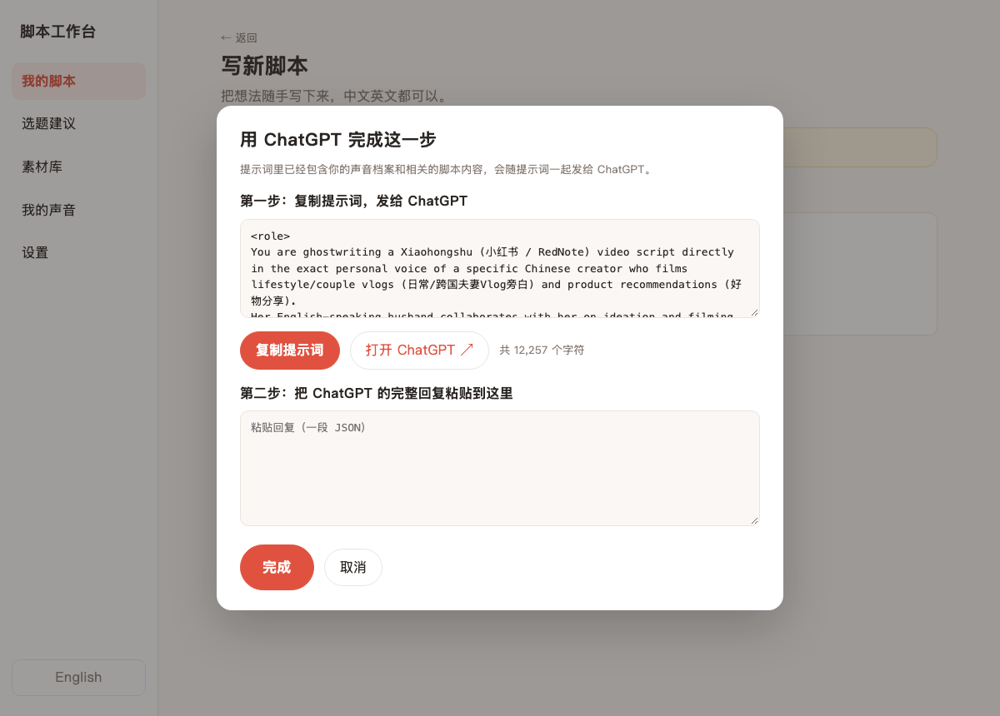
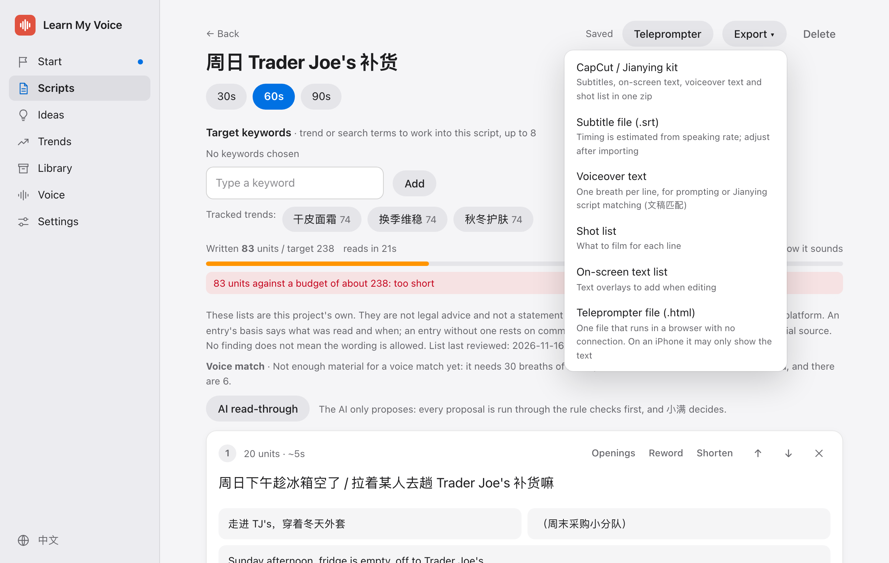

# Learn-My-Voice

**English** | [简体中文](README.zh-CN.md) · **[5-Minute Quick Start Guide](docs/QUICKSTART.md)** | **[5 分钟快速上手指南](docs/QUICKSTART.zh-CN.md)**

A local, bilingual (中文 / English) script studio for Xiaohongshu (RedNote) and other short-video creators.
It learns how one creator actually talks from her own past scripts, subtitles, and RedNote videos, drafts new scripts in that voice,
checks them, and hands the result to 剪映 (Jianying) / CapCut for editing.

It runs on your own computer. It comes in two forms: a desktop app with an installer for macOS and Windows, which needs nothing else, and a zip that needs only Python. On macOS, Python comes with Apple's free Command Line Tools, and the zip's launcher offers to install them if they are missing.



*Screenshots use invented sample data.*

## Status

This is an early version. Read this before relying on it.

| Area | State |
| :--- | :--- |
| Script editor, checks, teleprompter, library, exports | Working. Covered by automated tests and exercised in a real browser (headless Chrome, macOS). |
| AI steps (draft, learn voice, topic ideas) | Working against stand-in model replies in tests. Output quality with real models has not been evaluated yet. |
| Guided setup, voice review, lessons from edits | Covered by automated tests. Their AI parts were tested against stand-in replies, like the row above. |
| On-device transcription | A Mac with an Apple chip and macOS 14 or newer only. Set up and used on one Mac so far. Transcripts contain mistakes, especially in sentence-final particles, and wait for the creator's confirmation before their wording is learned from. |
| Trend keywords | Pasting, ranking and keyword checks work, are covered by automated tests and were exercised in headless Chrome. The ranking weights are judgement calls that have **not** been tuned against real results. Lookups by a web-searching AI have only been tested with stand-in replies. Importing a spreadsheet is new and was tested with made-up files only: no real export from 新红, 千瓜 or 灰豚, and no workbook saved by Excel, WPS or Numbers, has been tried. |
| One line to ideas | New. Typing or saying one line on 选题建议 looks current keywords up and then suggests ideas. Covered by automated tests, and the pages were run with the server in headless Chrome against stand-in AI replies. The web lookup through a Gemini or OpenAI key is written from those services' documentation and has **not** been run against either. Speaking was tested with the Whisper on one Mac and a sound stream in place of the microphone; a real microphone has **not** been tried. |
| 剪映 / CapCut | Exports standard files to import. Importing them has **not** been verified inside 剪映 or CapCut by the maintainers. It does not write 剪映 project drafts. |
| MCP server | Tested at protocol level (JSON-RPC over stdio). **Not** yet verified with ChatGPT, Codex or Claude Desktop. |
| Platforms | Developed on macOS with Python 3.9. Nobody has used it on Windows or Linux yet. The automated tests run on all three systems on GitHub's machines with Python 3.9, 3.14 and 3.15; as of 17 November 2026 they pass on all three, and the zip starts with its launcher on all three. Each release candidate's notes say what was found for that build, per system. |
| Desktop app | New. Installers for macOS (Apple chip and Intel chip) and 64-bit Windows are built on GitHub's machines, where each one is installed and the app is opened, used and ended before it is attached to a release candidate. **No person has installed one yet.** The installers are not signed, so the system has to be told once that the app may run. Transcribing videos in the desktop app needs a Mac with an Apple chip and Apple's free Command Line Tools; that was tried on one Mac with the app started from its source, **not** inside the desktop app. A microphone has not been tried in it, and there is no build for Linux. Before an installer is attached, the page in the installed app's own window has to open a script, export it, follow a link and delete the script by itself; what each trial found is attached to the release candidate as `desktop-<system>-trial.txt`. |

## Quick start

> **New here?** Start with the step-by-step **[Quick Start Guide](docs/QUICKSTART.md)** ([简体中文](docs/QUICKSTART.zh-CN.md)) for screenshots and a 5-minute walkthrough from first launch to CapCut / 剪映 export.

Release candidates are on the repository's
[Releases page](https://github.com/LetsLearntocodeforfun/Learn-My-Voice/releases). Each offers the app in two forms.

**As a desktop app.** Nothing else is needed: Python is inside it. Download the installer for your system:

| System | File | The first time |
| :--- | :--- | :--- |
| macOS, Apple chip | `learn-my-voice-<version>-macos-arm64.dmg` | Open the `.dmg` and drag Learn My Voice to Applications. Open it; macOS refuses. Then open System Settings, go to Privacy & Security, scroll down and click Open Anyway. |
| macOS, Intel chip | `learn-my-voice-<version>-macos-x64.dmg` | The same. |
| Windows, 64-bit | `learn-my-voice-<version>-windows-x64-setup.exe` | Run it. When "Windows protected your PC" appears, click More info, then Run anyway. |

The system objects because the installers are not signed: this project has no paid certificates. This is needed once. On a computer managed by an employer or a school it may not be allowed at all; the zip below, which runs with a Python the system already has, may still work there. Which chip a Mac has is shown under the Apple menu, About This Mac. The app opens in a window of its own. What it keeps (scripts, library, settings) is in the system's folder for application data, so installing a newer version keeps it. An export goes into your Downloads folder and the app says where it went; a link to another site opens in your browser. To transcribe videos, the desktop app needs a Mac with an Apple chip and Apple's free Command Line Tools, and says how to get them. No person has installed it yet: the notes of each release candidate say what GitHub's machines found when they installed and used that build.

**As a zip.** Requirements: Python 3.9 or newer. No packages to install. Download
`learn-my-voice-<version>.zip`, unpack it, and start it:

| System | Start it with |
| :--- | :--- |
| macOS | double-click `启动工作台.command` or `Start Learn My Voice.command`. macOS refuses to open it the first time: on macOS 15 or newer, open System Settings, go to Privacy & Security and click Open Anyway; on older versions, right-click the file and choose Open. |
| Windows | double-click `Start Learn My Voice.bat` |
| Linux | `sh start-learn-my-voice.sh` in a terminal |

The Windows and Linux launchers are new, and no person has used them yet. The notes of each release candidate
say whether that build started on each system on GitHub's machines, and give the SHA-256 of the zip.

**From the source.**

```bash
git clone https://github.com/LetsLearntocodeforfun/Learn-My-Voice.git
cd Learn-My-Voice
python3 -m studio.server
```

From the zip or the source, each start creates a fresh local access token and opens the studio in your browser (`http://127.0.0.1:8765/?token=...`, also printed as a launch link in the terminal window). Start it from the launcher rather than bookmarking the bare address. Settings shows which build is running.

The interface starts in Chinese. Use the **English** button at the bottom of the sidebar to switch.
It follows your computer's light or dark appearance; **Settings → Appearance** has light, dark and a choice of
accent colour. The language and the look are remembered, also the next time the desktop app is opened.

## First 10 minutes

1. **开始 / Start** opens the first time. Step 1: the creator's name, what they make, and phrases they never use.
2. Step 2: add material. Scripts written by hand (`.txt`, `.md`, `.docx`), subtitle files (`.srt`, `.vtt`), or videos on a Mac with an Apple chip. At least 3 non-sponsored items; 5 or more is better.
3. Step 3: choose how AI is provided (see the next section; the default needs no key) and have it propose a voice profile. Each item of the proposal is checked against the material. Decide item by item, then accept it.
4. Step 4: draft a first script. Under it the app lists which material the draft was based on.
5. **素材库 / Library**: add views, likes, collects and comments where you have them, and tick 商单 for sponsored items.
6. **热点 / Trends** (optional): paste keywords you see trending on Xiaohongshu to have them ranked against her own results.
7. **选题建议 / Ideas**: type one line about what you want to film, or say it, or leave the box empty, and click 找选题. With a Gemini or OpenAI key the app first looks up current keywords on the web and then suggests ideas. Pick an idea or a keyword and draft it.
8. **我的脚本 / Scripts**: edit the draft, read it with the teleprompter, and export the 剪映 kit.
9. Once the video is out: on the script, click **标记为已发布 / Mark as posted**, and type in the numbers when you have them. The script joins the library with its numbers, so the next ideas and the trend ranking can use how it did.

Until a voice profile has been accepted the app uses a bundled *example* voice profile for a fictional creator, and says so on screen.

## Ways to provide the AI

| Option | What you need | Where her text goes |
| :--- | :--- | :--- |
| **ChatGPT subscription (copy & paste)**, the default | A ChatGPT account, or any chat AI. No API key. | The chat you paste into |
| **MCP** | An AI app that supports MCP (see below) | That app's provider |
| **Google Gemini** or **OpenAI** API | An API key | Google or OpenAI |
| **Local model** | Ollama or LM Studio running on the same computer | Nowhere; it stays local |

### Copy & paste with a subscription

A ChatGPT subscription does not include API access, so the studio cannot call it directly. In this mode,
each AI step shows a prepared prompt. Paste it into ChatGPT, then either **choose / drag-and-drop a `.json` file** that ChatGPT generated or **paste the reply text** back (extra prose around code blocks, trailing commas, comments, and smart quotes are tolerated; on Step 3 and Voice you can also import a saved JSON reply directly if the dialog was closed).
The prompt contains her voice profile and the relevant script text.

Looking up trend keywords always works this way, whichever AI option is selected, because it needs an AI that can
search the web at that moment. That prompt contains her video titles rather than script text.



### Local models

Start Ollama or LM Studio, download a model, then choose **本地模型 / Local model** in Settings.
The studio lists whatever models are installed. Only addresses on the same computer are accepted.
Check your runtime's context-window setting: the prompts are long (often over 10,000 characters) and a small default window will cut them off.

### MCP server

`run_mcp.py` is a Model Context Protocol server over stdio. With it, an AI app does the writing while this
tool supplies her voice, her past scripts, the checks and the storage. Scripts saved through MCP appear in the studio.

Tools: `get_script_brief`, `save_script`, `update_script`, `check_script`, `list_scripts`, `get_script`,
`get_voice_profile`, `list_library`, `get_voice_learning_brief`, `save_voice_profile`,
`get_topic_ideas_brief`, `save_topic_ideas`, `export_jianying_kit`, `list_trends`, `add_trend_keywords`.

The setups below follow each vendor's documentation as of November 2026. None has been verified by the maintainers yet.
Use an absolute path; a path without spaces avoids quoting problems.

The Settings page shows the Codex configuration with the real paths of the app that is running: its Python, its
`run_mcp.py`, and after `--data-dir` the data folder it is using. Copy the paths from there. For the desktop app
this matters: its Python and its script are inside the app, and its data is in the system's folder for
application data, which `--data-dir` names. Without `--data-dir` the server uses the `data` folder next to
`run_mcp.py`, which is right for the zip and for a copy of the source.

**Codex (signed in with a ChatGPT plan)**: add to `~/.codex/config.toml`:

```toml
[mcp_servers.learn_my_voice]
command = "python3"
args = ["/absolute/path/to/Learn-My-Voice/run_mcp.py"]
```

The Settings page shows this snippet with the real paths filled in.

**ChatGPT on the web**: ChatGPT can add a custom MCP server, but it must be reachable over HTTP or through
OpenAI's Secure MCP Tunnel; it cannot start a local program by itself. The tunnel client can launch this server:

```bash
tunnel-client init --sample sample_mcp_stdio_local --profile learn-my-voice \
  --tunnel-id <your tunnel id> \
  --mcp-command "python3 /absolute/path/to/Learn-My-Voice/run_mcp.py"
tunnel-client run --profile learn-my-voice
```

OpenAI's guide says the tunnel needs a tunnel id and an API key from the OpenAI Platform for the tunnel itself.
See [Add custom MCP server](https://developers.openai.com/api/docs/guides/custom-mcp-server) and
[Secure MCP Tunnel](https://developers.openai.com/api/docs/guides/secure-mcp-tunnels).

**Claude Desktop and other stdio clients**:

```json
{ "mcpServers": { "learn-my-voice": { "command": "python3", "args": ["/absolute/path/to/Learn-My-Voice/run_mcp.py"] } } }
```

Then ask in chat, for example: *"Use Learn My Voice to write a 60-second script about our weekend Costco run."*

## What it does

- **Script editor**: one card per spoken line, with shot and on-screen text (花字) fields, live character count and read time, autosave.
- **Live checks**, in Chinese and English: lines too long for one breath, phrases she never uses, influencer clichés, translated-sounding Chinese, risky advertising wording, and total length against the target duration. These are rules, not AI, so they are instant and repeatable.
- **Guided setup** (开始 / Start): five steps: who the creator is, their material, their voice, a first script, and what keeps learning afterwards. Each step says what leaves the computer and what does not.
- **Material & visual RedNote video ingestion**: scripts written by hand (`.txt`, `.md`, `.docx`), subtitle files (`.srt`, `.vtt`), and video/audio files (`.mp4`, `.mov`, `.m4a`, `.mp3`, `.wav`) on both Start and Library, with inline video preview and visual keyframes. Videos can be transcribed offline on an Apple-chip Mac, analyzed for speech + tone + `花字` via Gemini, transcribed via OpenAI, or ingested with zero API key via ChatGPT/Gemini copy-paste. Subtitle files and videos carry timestamps, so speaking rate is measured from them.
- **Voice learning**: an AI reads the material and proposes a voice profile. Code then looks up every phrase the proposal attributes to the creator in that material. The review shows what was found, what was not, what the AI wanted to ban although the creator says it, and all 21 descriptive Voice DNA fields (with notes linked to the entries they describe). Nothing takes effect until the creator accepts the proposal. Breath-length limits are measured in code once there are 30 breaths of material. Sponsored scripts are kept out of the core profile. Earlier profiles are kept and can be restored.
- **References beside the editor** (参考 / References): while editing a script, open the side panel to see items pinned to that script, which items the AI draft's prompt saw, related library items on the same topic, and a full-text search of the library — all computed locally in code without calling an AI.
- **Line tools & structured AI read-through**: per-line **Openings**, **Reword**, and **Shorten** proposals plus a script-wide **AI read-through** critic pass with structured, inspectable reasons. Every proposal runs through the deterministic rule checks first and waits for **Use this** (with Undo).
- **Drafting**: every draft is anchored on her own best-performing scripts as examples. A script can have up to 8 target keywords; her past scripts on those topics are then used as the examples first, and the editor shows whether each keyword ended up in the spoken lines or in the drafted title options, caption or hashtags. The title options, cover text, caption and hashtags that the AI drafts with a script are shown under it, to read and copy.
- **Lessons from edits**: each AI draft lists which of the creator's scripts its prompt contained. The app shows what the creator then changed in the draft, counting wording only, and a change can be remembered. Remembered changes go into later draft prompts, and a phrase removed in more than one script is offered for the never-say list.
- **Topic ideas**: ranks her past videos by interactions and suggests what to film next. Each idea must cite her own videos; citations that do not match a real title are removed. Tracked trend keywords are passed in as a second signal, and an idea can only name keywords that are actually tracked.
- **One line to ideas**: on 选题建议, and on the home page once an AI is connected, type one line about what you want to film, or say it on a Mac that has the on-device transcriber. With a Gemini or OpenAI key the app first asks that service to search the web for current keywords in the creator's niches, keeps the ones that come with a source link, marked as unverified, and then asks for ideas that answer the line. With a local model or in copy & paste mode the same two steps are offered by hand. The page shows the ideas, the keywords found with their sources, and the pages the lookup cited. When one step fails the other's result is still shown, and ideas saved earlier stay.
- **Trend keywords** (热点): paste keywords you see trending, with an optional heat number, or import a keyword list saved from an analytics tool as `.csv`, `.tsv`, `.txt` or `.xlsx`. For a file, the studio shows which columns it took for the keywords and for the number and how the first rows read; you can change the columns, and nothing is stored until you click Import. The studio ranks the keywords by how hot and recent they are and by how her own videos on that topic performed. You choose how much each side counts. The ranking is arithmetic, not AI. Keywords that clash with her voice profile are marked and left out of suggestions. A web-searching chat AI can also look keywords up through the copy & paste dialog or MCP; those need a source link and are labelled as unverified.
- **Teleprompter**: full screen, adjustable speed and size.
- **Mark as posted**: a script written in the studio that was filmed and posted becomes one library item, with the day it was posted, an optional link (kept as text, never opened) and its numbers. The numbers count at once wherever her own results are used. The day the numbers were read is kept beside them and shown as days after posting; nothing is adjusted or projected. The wording does not count as hers until she confirms it, or attaches the video's subtitle file or a transcript, because the text may have begun as an AI's draft. The page says how many lines are still exactly as the AI wrote them, counted in code. An opening that is still the AI's sentence is never listed among her own openings.
- **Word list** (设置 / Settings): the checks flag advertising wording that may be a problem, and each finding says what its entry rests on: an article of the Advertising Law that was read, or that no source was checked. A separate kind of finding, labelled "hint only", marks wording that may sound written rather than spoken; it is never counted as a problem. Any entry can be switched off, and you can add phrases of your own. The list is this project's own: it is not legal advice and not a statement of Xiaohongshu's rules, and a script with no finding is not thereby allowed.
- **Backup and restore** (设置 / Settings): packs scripts, library items, the creator profile, the active and earlier voice profiles, tracked keywords, remembered edits, and word-list changes into one portable backup file (API keys are never included). Restoring previews the archive first and saves an automatic backup of current data so a restore can be undone.
- **Exports**: 剪映 / CapCut kit, subtitle `.srt`, voiceover text, shot list, on-screen text list, standalone `.html` teleprompter.


## 剪映 (Jianying) / CapCut

From a script, **导出 → 剪映素材包** downloads a zip:

| File | Use |
| :--- | :--- |
| `口播文稿.txt` | One breath per line. Paste into 剪映's 文稿匹配 (script matching) to get subtitles aligned to the real recording. |
| `字幕.srt` | Subtitle file to import. **Timing is estimated** from her speaking rate, not taken from a recording, so it needs adjusting. |
| `花字.srt` | On-screen text placed near the line it belongs to. |
| `拍摄清单.txt` | What to film for each line. |
| `使用说明.txt` | Import steps. |

Switch the app to English before exporting to get English file names and instructions.



What it does not do yet: write a 剪映 project draft with clips and text already on the timeline, or time subtitles
from her actual audio. The draft format is undocumented and unreadable in recent versions, and the main open-source
generator reports limits for drafts produced on macOS, so this needs testing against a real installation first.

## Data and privacy

- Everything is stored in `data/` inside the project folder: scripts, library, the creator profile from setup, voice profile, settings. The folder is git-ignored, and on macOS and Linux it is closed to the other accounts on the computer.
- API keys are encrypted at rest via `studio/keystore.py` (Windows DPAPI or a `0600` key in your OS application-config folder on macOS/Linux) rather than stored in plaintext in `data/config.json`, and are never sent back to the browser or included in backups. If `data/` is moved to another machine, sealed keys are preserved untouched until you enter a key on that machine.
- The web server listens on `127.0.0.1` only, requires a per-launch local capability token and port-scoped session cookie, checks `Host` and `Sec-Fetch-Site` headers, and refuses requests from other websites. See [docs/SECURITY_NOTES.md](docs/SECURITY_NOTES.md) for details.
- AI steps send the creator profile, her voice profile, her notes and parts of her past scripts to whichever AI you chose. With a local model nothing leaves the computer.
- A video added for transcription is copied into `data/uploads/` and transcribed on this Mac. The copy is deleted when the transcription ends, whatever the outcome; only the text and timing are kept. The programs that transcribe are started under macOS rules that deny them the network, and where those rules cannot be set up nothing is transcribed.
- Setting up transcription downloads software from pypi.org and one speech model from huggingface.co, about 2 GB in all, into `local_tools/whisper/` inside the project folder. Nothing about the creator is sent.
- Views, likes, collects and comments are typed in by hand. Nothing is fetched from any platform.
- Trend keywords are pasted in by hand, imported from a file you choose, or looked up by a web-searching AI. An imported file goes to this app on `127.0.0.1`, is read there and is not kept; no AI is involved. That is either one you ask yourself by copy and paste, or, when 选题建议 is used with a Gemini or OpenAI key and the lookup is ticked, that service's own web search. The studio itself opens no web page and fetches nothing from any platform. A trend lookup prompt contains the niches from the creator profile, the titles of up to 20 non-sponsored videos, the line you typed or said and the keywords already tracked. It does not contain script text, the creator's name or anything from the voice profile. The ideas prompt that follows is a separate request, sent without web search.
- A spoken line is recorded in the browser, sent to this app on `127.0.0.1`, turned into text by the on-device transcriber and deleted. The browser's own speech recognition is not used. The text appears in the box first; nothing goes to an AI until 找选题 is clicked.

## Project layout

| Path | Contents |
| :--- | :--- |
| `studio/server.py`, `studio/web/` | Local web server and the interface |
| `studio/guardrails.py`, `studio/lexicon.json`, `studio/checks.py` | Rule-based checks and their bilingual messages |
| `studio/pipeline.py`, `studio/llm.py` | Prompt building, reply validation, model providers |
| `studio/corpus.py` | Reading her scripts, measured statistics, performance ranking |
| `studio/creator.py`, `studio/setup.py` | The creator profile from setup, and where setup stands |
| `studio/evidence.py` | Looks up what a proposed voice profile claims in the creator's own material |
| `studio/refs.py`, `studio/web/refs.js` | References panel beside the script editor (pins, draft basis, related items, search) |
| `studio/keystore.py` | OS-backed sealing for API keys and Windows `data/` ACL restriction |
| `docs/QUICKSTART.md`, `docs/QUICKSTART.zh-CN.md` | Bilingual 5-minute Quick Start Guide with screenshots |
| `studio/learning.py` | Compares an AI draft with the creator's version |
| `studio/timing.py` | Subtitle files, and speaking rate measured from their timestamps |
| `studio/transcribe.py`, `studio/whisper_worker.py`, `studio/jobs.py` | On-device transcription and its background jobs |
| `studio/trends.py` | Reading pasted trend keywords, scoring them against her own results, keyword coverage |
| `studio/keyword_import.py` | Reading a keyword list from a `.csv`, `.tsv`, `.txt` or `.xlsx` file, with limits on what a file can make the app do |
| `studio/exports.py` | Text exports, `.srt`, 剪映 kit |
| `studio/mcp_server.py`, `run_mcp.py` | MCP server |
| `studio/buildinfo.py` | Which build is running: the version from a release package, or "from source" |
| `prompts/` | The prompt text. The app reads prompts 02, 04, 06 and 07 directly from these files, so editing them changes behaviour. |
| `.github/workflows/tests.yml` | Runs the tests on macOS, Windows and Linux on every push |
| `.github/workflows/release-candidate.yml` | On a push to a `beta/...` branch: tests, builds the zip, tries it on the three systems, publishes a pre-release |
| `tools/build_release.py`, `tools/try_release.py`, `tools/run_tests.py` | What those workflows run; they run the same on a desk. Not part of the download. |
| `SYSTEM_DESIGN.md` | The original, larger design. Parts of it are not built. |

The prompts receive the creator profile from setup (name, niches, an on-camera partner, phrases never
to be used) and no longer assume one particular creator. They are written for Xiaohongshu video scripts in Chinese.

## Development

```bash
python3 -m unittest discover -t . -s tests        # all tests, no dependencies
python3 tools/build_release.py build              # the zip a release would hold, from the last commit, into dist/
python3 tools/try_release.py dist/learn-my-voice-*.zip    # unpack it, start it with its launcher, use it, stop it
python3 -m studio.guardrails tests/fixtures/worked_example_script.json --dna schemas/voice_dna.example.json
```

## Known limits

- The advertising-rule word lists are a starting point collected for this project. They have not been checked against current platform or legal rules and are not legal advice.
- Speaking rate cannot be learned from text. It is measured once the library holds at least a minute of timed material (subtitle files or transcribed videos). Until then it is a default, or the number the creator types in.
- On-device transcription only runs on a Mac with an Apple chip, macOS 14 or newer, and the Python that comes with Apple's Command Line Tools (3.9). It has been set up and used on one Mac so far. Whisper gets some sentence-final particles wrong: in testing on synthetic speech it wrote 嘛 as 吗, 呗 as 背, 喔 as 哦 and 呐 as 呢. So a transcript is used to learn wording only after the creator has read and confirmed it.
- With only a few videos that have numbers, topic suggestions are weak. The app says so.
- Trend scores are a guide, not a measurement. The weights and the 14-day half-life are judgement calls that have not been tuned against real outcomes, and heat numbers are whatever was typed in. Matching a keyword to her past videos is by shared characters and words, so it can miss a video that covers the topic in other words.
- Importing a keyword spreadsheet reads the first sheet of a workbook, at most 5,000 rows and 50 columns, and takes at most 200 keywords per import. Which column holds the keywords is a guess from the header names and the contents; the names it looks for (关键词, 热词, 搜索指数 and others) were chosen without having seen a real export, so check the preview. Old `.xls` files and workbooks with a password are refused.
- Keywords found by an AI are only as good as the page it cites. The studio requires a web link and drops entries whose stated source date is more than 30 days old, but it never opens the page, so it cannot confirm the page says what the AI claims. They stay marked as unverified unless you paste the same keyword in yourself.
- The web lookup built into 选题建议 is written from Google's and OpenAI's documentation as it read on 16 November 2026 and has not been run against either service. For Gemini it uses the Interactions API, which is not the API the rest of the app calls. OpenAI asks that pages a web search cites are shown as clickable links, which the page does. Google sends an HTML snippet of search suggestions that is meant to be shown, with requirements in its terms of service; the app does not show it, and those terms have not been read.
- Speaking a line needs the on-device transcriber, so it works only where video transcription does. Whisper mishears: in a test with a synthetic Chinese voice it wrote 秋冬 as 邱中. The text is shown in the box to be corrected before anything is sent.
- Sponsored-brief handling and a second-pass critic are designed in `prompts/` and `SYSTEM_DESIGN.md` but not built.

## License

MIT. See [LICENSE](LICENSE).
