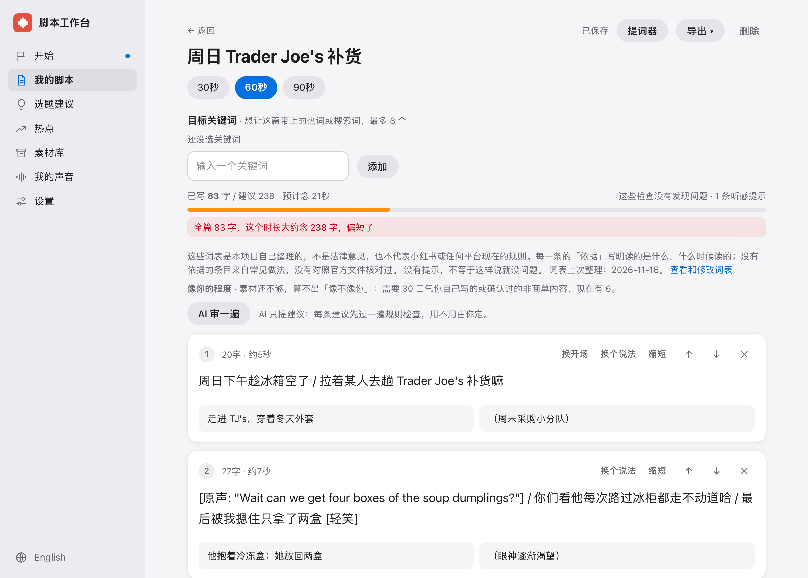
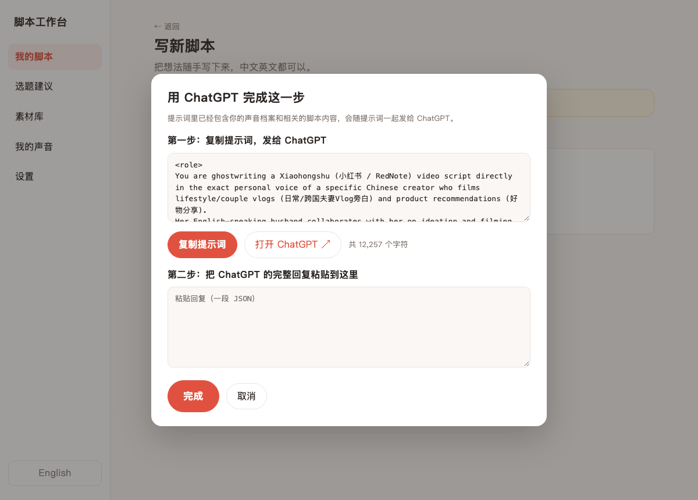
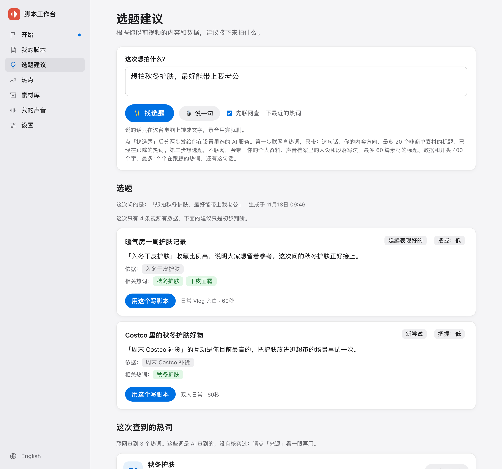

# Learn-My-Voice

[English](README.md) | **简体中文** · **[5 分钟快速上手指南](docs/QUICKSTART.zh-CN.md)** | **[Quick Start Guide](docs/QUICKSTART.md)**

一个在自己电脑上运行的中英双语脚本工作台，给小红书和其他短视频创作者用。
它从你以前亲手写的脚本、字幕和小红书视频里学习你平时怎么说话，照着你的口吻写新脚本、帮你检查，再把结果交给剪映（国际版叫 CapCut）去剪辑。

它有两种用法：一种是桌面应用，macOS 和 Windows 都有安装包，装上就能用，不需要别的东西；另一种是压缩包，只需要电脑上有 Python。在 macOS 上，Python 包含在苹果免费的「命令行工具」里；如果还没装，压缩包里的启动文件会提示你安装。



*截图里用的是虚构的示例数据。*

## 目前的状态

这是早期版本，使用前请先看这一段。

| 部分 | 状态 |
| :--- | :--- |
| 脚本编辑、检查、提词器、素材库、导出 | 可以用。有自动化测试，也在真实浏览器里跑过（macOS 上的无界面 Chrome）。 |
| AI 功能（写初稿、学习声音、选题建议） | 测试里用的是模拟的模型回复。真实模型写出来的质量还没有评估过。 |
| 引导设置、声音档案确认、从改稿中学习 | 有自动化测试。其中用到 AI 的部分和上一行一样，只用模拟回复测试过。 |
| 本机视频转写 | 只支持 Apple 芯片的 Mac，macOS 14 或更新。目前只在一台 Mac 上安装并用过。机器转写会有错字，尤其是句尾语气词，所以转写的文字要你确认以后，才会用来学说话习惯。 |
| 热点关键词 | 粘贴、排序和关键词检查可以用，有自动化测试，也在无界面 Chrome 里跑过。排序的权重是凭经验定的，**还没有**用真实结果校准过。让能联网的 AI 查热词这一步，只用模拟回复测试过。从表格导入是新功能，只用自己编的文件测试过：新红、千瓜、灰豚真实导出的文件，以及 Excel、WPS、Numbers 保存的工作簿，都**还没有**试过。 |
| 一句话找选题 | 新功能。在「选题建议」里写一句或说一句，先查最近的热词，再给选题。有自动化测试，页面和服务也一起在无界面 Chrome 里跑过，用的是模拟的 AI 回复。用 Gemini 或 OpenAI 密钥联网查热词这一步，是照着这两家的文档写的，**还没有**真的连过任何一家。说话输入是用一台 Mac 上的 Whisper 测的，用一段声音代替了麦克风；真实的麦克风**还没有**试过。 |
| 剪映 / CapCut | 导出的是可以导入的标准文件。维护者**还没有**在剪映或 CapCut 里实际验证过导入。目前不会直接生成剪映草稿。 |
| MCP 服务 | 20 个工具在协议层面测试过（标准输入输出上的 JSON-RPC），包含评论长度限制、自动去除评论者昵称、`add_video_plan` 仅存为待确认 `IDEA`（上限 50 条）以及只读 `get_autopilot_status`。**还没有**和 ChatGPT、Codex 或 Claude Desktop 实际连通验证。 |
| 版本更新与跨版本迁移 | 启动时最多每 12 小时查一次 GitHub Releases（可在「设置」关闭，或通过环境变量 `LEARN_MY_VOICE_NO_UPDATE_CHECK=1` 禁用）、流式下载并核对发布的 `.sha256` 校验文件、桌面版系统应用数据目录自动保留、压缩包仅限空目录安全迁移并对 `config.json` 逐项核验及提前展示将迁入的 AI 服务/模型（不复制 `local_tools/whisper`）。只用本机模拟传输测试过，自动化测试里**没有**连过真实的 `api.github.com`。SHA-256 只证明下载完整且与发布文件一致，不证明版本经过数字证书签名；安装包目前没有代码签名。 |
| 按日数据、创作者中心表格导入与评论分析 | 按天记录 `metric_snapshots`（含日均播放 `views/day`）、两步预览再导入 `.csv`/`.tsv`/`.txt`/`.xlsx` 表格、识别否定词的本地评论词表计数、XML 隔离的第 9 步 AI 评论归纳，以及评论截图文字提取预览。只用虚构表格和模拟回复测试过：**没有**见过或试过小红书创作服务平台真实导出的表格，视觉和评论归纳接口也**没有**连过真实的云端服务。 |
| 拍摄计划（`#/plan`） | 列表、周历和月历三种视图，行内直接修改标题/备注/日期/时长/形式，从观众提问和已存选题批量加入计划，自动学习的非破坏性热词建议标签（采纳 / 忽略），以及把计划一键变成关联脚本（支持设置里的 AI、复制粘贴或空白脚本）。有自动化测试，并在无界面 Chrome（中文浅色、英文深色）中验证。没有测试按过键盘，所以**尚未**验证只用键盘能否完成全部操作。 |
| 说话习惯统计与声音测量 | 在「我的声音」页和脚本编辑页「口吻接近度」旁，统计语气词、口语/书面连接词、叠词、保留说法、硬广套话、每口气问号和感叹号并对照非商单已确认素材的范围；转写视频时从临时 16 kHz WAV 测量停顿密度、响度范围（dB）和自相关音高估计（Hz / 半音跨度）。已在合成 WAV 和 macOS `say` 语音上验证，**没有**在真实小红书口播录音或 Praat 等外部声学软件上比对过。 |
| 商单 Brief 与编辑页核对清单（`#/sponsored`） | 支持粘贴或导入 `.txt`/`.md`/`.docx` 商单 Brief（明确拒绝 PDF 和旧版 `.doc`），生成中英双语白话摘要、原文核对过的必提要求、日常切入角度、第 4 步商单模式写稿（原始 Brief 绝不进第 4 步提示词）、编辑页实时核对清单，以及删除时 `PRAGMA secure_delete` 覆写清零。只用合成 `.docx` 和模拟回复测试过，**没有**用真实品牌 Brief 或真实模型跑过。 |
| Anthropic Claude 与视频分镜库（Beat Bank） | 新增 Anthropic Messages 客户端（`provider="anthropic"`）、涵盖 Gemini / OpenAI / Anthropic / 本地模型的截断与拒答结束原因检查（`llm.PROVIDER_STOP_REASON_UNCHECKED`）、统一的各阶段 `temperature` 配置（遇 HTTP 400 自动去掉 `temperature` 重试一次），以及第 1B 步视频分镜 `sample_beats` 存储、素材库与「参考」面板展示、仅把已确认非商单 `spoken_text` 与类型枚举送入 `<creator_beat_examples>`（绝不带模型改写文字或 `LIVE_CLIP`）。Anthropic 客户端（`llm.ANTHROPIC_UNCHECKED`）与结束原因解析均依据文档编写并用模拟回复测试，**从未**连过真实的云端接口。 |
| 自动学习（`#/autopilot`） | 可选的后台持续学习与趋势跟进（默认关闭；设置 `LEARN_MY_VOICE_NO_AUTOPILOT=1` 时本次会话禁用），支持「只给建议」与有安全边界的「自动处理」两档、每日模型调用上限、监控文件夹自动导入视频/音频与热词表格（`voice.ingest_folder`，`sponsored/` 与 `商单/` 子文件夹自动标为商单）、持续更新声音档案（`voice.relearn`）与采纳高频改稿习惯（`lessons.accept_recurring`）、定时联网查热词与遵守 `robots.txt` 的公开 `https://` 热词页读取（`trends.refresh`，严禁抓取 `xiaohongshu.com` / `rednote.com`）、为近期拍摄计划挂载热词建议（`plans.suggest`）及生成候选选题集（`ideas.refresh`），每次运行均可一键**撤销**。已在单元测试和无界面 Chrome（中文浅色、英文深色）用模拟传输验证，**尚未**连着真实云端接口或公开网站连续数日无人值守试跑。 |
| 系统 | 在 macOS、Python 3.9 上开发。还没有人在 Windows 或 Linux 上实际用过。自动化测试在 GitHub 的机器上跑三个系统，各用 Python 3.9、3.14 和 3.15：截至 2026 年 11 月，三个系统都通过了，压缩包在三个系统上也都能用启动文件打开。每个候选版本的发布说明里，会写这个版本在每个系统上测出来的结果。 |
| 桌面应用 | 新功能。macOS（Apple 芯片和 Intel 芯片）和 64 位 Windows 的安装包都在 GitHub 的机器上生成；每个安装包都要在那里装一遍，把应用打开、用一遍、再关掉，通过了才会附在候选版本里。**还没有人亲手装过。**安装包没有签名，所以第一次要告诉系统「允许运行」。在桌面应用里转写视频，需要 Apple 芯片的 Mac，并且装有苹果免费的「命令行工具」；这条路只在一台 Mac 上、用源代码启动工作台的方式试过，**还没有**在桌面应用里试过。麦克风也还没有试过，目前没有 Linux 版。安装包附上之前，装好的应用要在自己的窗口里自己走一遍：打开一篇脚本、导出、点一个外部链接、再把脚本删掉；每次试出来的结果以 `desktop-<系统>-trial.txt` 附在候选版本里。 |

## 快速开始

> **第一次用？** 直接看图文并茂的 **[5 分钟快速上手指南](docs/QUICKSTART.zh-CN.md)**（[English Quick Start](docs/QUICKSTART.md)），从打开应用到导出剪映素材包一步步带你走通。

候选版本在仓库的
[Releases 页面](https://github.com/LetsLearntocodeforfun/Learn-My-Voice/releases)。每个版本都有两种用法。

**用桌面应用。** 不需要别的东西，Python 已经装在里面。按你的电脑下载对应的安装包：

| 系统 | 文件 | 第一次打开 |
| :--- | :--- | :--- |
| macOS，Apple 芯片 | `learn-my-voice-<版本号>-macos-arm64.dmg` | 打开 `.dmg`，把 Learn My Voice 拖到「应用程序」。第一次打开会被拦住：请到「系统设置」→「隐私与安全性」，往下找到「仍要打开」。 |
| macOS，Intel 芯片 | `learn-my-voice-<版本号>-macos-x64.dmg` | 同上。 |
| Windows，64 位 | `learn-my-voice-<版本号>-windows-x64-setup.exe` | 运行它。出现「Windows 已保护你的电脑」时，点「更多信息」，再点「仍要运行」。 |

系统会拦，是因为安装包没有签名：这个项目没有付费的证书。只需要这样做一次。如果电脑是公司或学校管理的，可能根本不允许运行；这种情况下，下面的压缩包也许还可以用，因为它用的是系统里已有的 Python。Mac 用的是哪种芯片，可以在苹果菜单的「关于本机」里看到。应用会在自己的窗口里打开。它保存的内容（脚本、素材库、设置）放在系统的应用数据文件夹里，所以装新版本不会丢。导出的文件会放进你的「下载」文件夹，应用会告诉你放在哪里；外部链接会在你的浏览器里打开。在桌面应用里转写视频，需要 Apple 芯片的 Mac 和苹果免费的「命令行工具」，没装的话应用会告诉你怎么装。还没有人亲手装过：每个候选版本的发布说明里，会写 GitHub 的机器安装并使用这个版本时测出来的结果。

**用压缩包。** 需要 Python 3.9 或更新版本，不用安装任何依赖。下载
`learn-my-voice-<版本号>.zip`，解压后这样启动：

| 系统 | 启动方法 |
| :--- | :--- |
| macOS | 双击 `启动工作台.command`（或 `Start Learn My Voice.command`）。第一次 macOS 会拦住：macOS 15 或更新的版本，请打开「系统设置」→「隐私与安全性」，往下找到「仍要打开」；更早的版本，右键点这个文件，选择「打开」。 |
| Windows | 双击 `Start Learn My Voice.bat` |
| Linux | 在终端里运行 `sh start-learn-my-voice.sh` |

Windows 和 Linux 的启动文件是新加的，还没有人实际用过。每个候选版本的发布说明里，会写这个版本在 GitHub
的机器上、在每个系统上能不能启动，并附上压缩包的 SHA-256。把新版 `.zip` 解压在旧版文件夹旁边时，可以在 **设置 → 版本与更新** 里把旧版的 `data/`（设置、封存的密钥、声音档案、脚本、素材库、计划）迁进刚解压的空文件夹（`local_tools/whisper` 不会复制，如使用本机转写需在新文件夹重新安装）。

**从源代码运行。**

```bash
git clone https://github.com/LetsLearntocodeforfun/Learn-My-Voice.git
cd Learn-My-Voice
python3 -m studio.server
```

用压缩包或源代码运行时，每次启动都会生成一把新的本机访问口令，并在浏览器里打开带口令的地址（`http://127.0.0.1:8765/?token=...`，终端窗口也会打印「安全访问链接」）。每次请从启动文件打开，不要把不带口令的地址存成书签。「设置」页的最下面会显示正在运行的是哪个版本。

界面默认是中文。点左下角的 **English** 可以切换成英文。
界面会跟随电脑的浅色或深色外观；在 **设置 → 外观** 里可以选浅色、深色，也可以换强调色。
语言和外观会记住，下次打开桌面版也一样。

## 头十分钟怎么用

1. 第一次打开会进入**开始**页。第一步：怎么称呼你、主要拍什么、你坚决不说的话。
2. 第二步：放素材。以前亲手写的脚本（`.txt`、`.md`、`.docx`）、字幕文件（`.srt`、`.vtt`），或者直接放视频（只支持 Apple 芯片的 Mac）。非商单素材至少 3 篇，5 篇以上更好。
3. 第三步：选择 AI 的来源（见下一节，默认的方式不需要密钥），让它读你的素材、提出一份声音档案。提议里的每一条都会回到你的素材里核对。你逐条决定，然后点采用。
4. 第四步：写第一篇脚本（如果是商单合作，可以在新建脚本页点进 **商单 Brief** 先把品牌要求翻成日常切入点）。脚本下面会列出这篇初稿参照了你的哪些素材。
5. **素材库**：填上播放、点赞、收藏、评论，或者先预览再导入创作者中心导出的表格，也可以粘贴评论区留言（评论者昵称会自动剥掉、绝不保存）统计提问或让 AI 归纳；商单请勾选「商单」。
6. **热点**（可选）：把你在小红书看到的热词贴进来，让它结合你自己的数据排个先后。
7. **选题建议**、**拍摄计划**与**自动学习**（可选）：生成有依据的选题，把观众常问的问题或存下的选题批量加进拍摄日历（支持列表、周历、月历），从计划直接生成关联脚本；还可以在 **自动学习**（`#/autopilot`）开启后台监控文件夹导视频/导热词表、持续进化声音档案、刷新公开热词并为近期计划推荐关键词。
8. **我的脚本**：对照口吻接近度、用词习惯、右侧「参考」（含同类型视频分镜）和商单核对清单改稿，用提词器念，再导出剪映素材包。
9. 视频发出去以后：在这篇脚本上点**标记为已发布**，陆续填上或导入不同日期的数据（自动算日均播放 `views/day`）。脚本会带着数据进素材库，关联的拍摄计划也会自动变成已发布。

在采用你自己的声音档案之前，工作台用的是自带的*示例*声音档案（一个虚构的博主），页面上会有提示。

## AI 从哪里来

| 方式 | 需要什么 | 你的文字会发到哪里 |
| :--- | :--- | :--- |
| **ChatGPT 订阅（复制粘贴）**，默认 | 一个 ChatGPT 账号，或任何聊天类 AI。不需要 API 密钥。 | 你粘贴进去的那个聊天窗口 |
| **MCP** | 支持 MCP 的 AI 应用（见下文） | 那个应用的服务商 |
| **Google Gemini**、**OpenAI** 或 **Anthropic Claude** 的 API | API 密钥 | Google、OpenAI 或 Anthropic |
| **本地模型** | 在同一台电脑上运行的 Ollama 或 LM Studio | 不会离开这台电脑 |

### 用订阅复制粘贴

ChatGPT 订阅不包含 API，所以工作台没办法直接调用它。在这个模式下，每次需要 AI 时，工作台会准备好一段提示词：
把它粘贴给 ChatGPT，然后**直接选择/拖入 ChatGPT 生成的 `.json` 文件**，或者**把回复文字粘贴回来**（前后多出的解释文字、多余逗号、注释和弯引号都能自动兼容；如果弹窗不小心关了，还可以在「开始」第 3 步或「我的声音」页直接导入保存好的 JSON 回复）。提示词里包含你的声音档案和相关的脚本内容。

在未启用 Gemini / OpenAI 自带联网查词时，查热词用这种方式完成，因为它需要一个当时就能联网搜索的 AI。那段提示词里放的是你的视频标题，不是脚本正文。



### 本地模型

先打开 Ollama 或 LM Studio 并下载好模型，再到「设置」里选择**本地模型**。工作台会列出已经安装的模型。只接受这台电脑上的地址。
请检查本地模型的上下文长度设置：提示词比较长（经常超过一万个字符），默认值太小的话会被截断。

### MCP 服务

`run_mcp.py` 是一个通过标准输入输出通信的 MCP（Model Context Protocol）服务。接上以后，由 AI 应用负责写，
工作台负责提供你的声音档案、以前的脚本、检查规则和保存。通过 MCP 保存的脚本会出现在工作台里。

提供的工具（20 个）：`get_script_brief`、`save_script`、`update_script`、`check_script`、`list_scripts`、`get_script`、
`get_voice_profile`、`list_library`、`get_voice_learning_brief`、`save_voice_profile`、
`get_topic_ideas_brief`、`save_topic_ideas`、`export_jianying_kit`、`list_trends`、`add_trend_keywords`、
`get_rednote_analytics`、`get_tone_analysis`、`list_video_plans`、`add_video_plan`、`get_autopilot_status`。

下面的配置方法来自各家截至 2026 年 11 月的官方文档，维护者都还没有实际验证过。
路径请用绝对路径；路径里没有空格可以避免引号问题。

「设置」页会显示 Codex 的配置，里面是正在运行的这个工作台的真实路径：它用的 Python、它的 `run_mcp.py`，
以及 `--data-dir` 后面它正在用的数据文件夹。路径请从那里复制。桌面应用尤其要这样做：它的 Python 和脚本都在应用里面，
数据则在系统的应用数据文件夹里，`--data-dir` 指的就是那个文件夹。不写 `--data-dir` 时，服务用的是 `run_mcp.py`
旁边的 `data` 文件夹，这对压缩包和源代码是对的。

**Codex（用 ChatGPT 订阅登录）**：在 `~/.codex/config.toml` 里加上：

```toml
[mcp_servers.learn_my_voice]
command = "python3"
args = ["/absolute/path/to/Learn-My-Voice/run_mcp.py"]
```

「设置」页面里会显示填好真实路径的这段配置。

**ChatGPT 网页版**：ChatGPT 可以添加自定义 MCP 服务，但服务必须能通过 HTTP 访问，或者通过 OpenAI 的 Secure MCP Tunnel 连接；
它不能自己启动本地程序。Tunnel 客户端可以启动本服务：

```bash
tunnel-client init --sample sample_mcp_stdio_local --profile learn-my-voice \
  --tunnel-id <你的 tunnel id> \
  --mcp-command "python3 /absolute/path/to/Learn-My-Voice/run_mcp.py"
tunnel-client run --profile learn-my-voice
```

按照 OpenAI 的说明，Tunnel 本身需要在 OpenAI Platform 上申请一个 tunnel id 和一个 API 密钥。
详见 [Add custom MCP server](https://developers.openai.com/api/docs/guides/custom-mcp-server) 和
[Secure MCP Tunnel](https://developers.openai.com/api/docs/guides/secure-mcp-tunnels)。

**Claude Desktop 和其他支持 stdio 的客户端**：

```json
{ "mcpServers": { "learn-my-voice": { "command": "python3", "args": ["/absolute/path/to/Learn-My-Voice/run_mcp.py"] } } }
```

然后在聊天里说，比如：*「用 Learn My Voice 帮我写一个 60 秒的脚本，讲我们周末去 Costco 补货。」*

## 功能

- **脚本编辑**：一句话一张卡片，可以填画面和花字，实时显示字数和大概要念多久，自动保存。
- **实时检查**（中英文提示）：一口气念不完的长句、你从来不说的词、营销号套话、翻译腔、可能违规的广告用语，以及全篇长度和目标时长是否匹配。这些是规则不是 AI，所以即时、每次结果一致。
- **引导设置**（「开始」页）：一共五步：关于你、你的素材、你的声音、第一篇脚本、越用越像你。每一步都写明什么会离开这台电脑、什么不会。
- **素材与小红书视频可视化导入**：亲手写的脚本（`.txt`、`.md`、`.docx`）、字幕文件（`.srt`、`.vtt`），以及在「开始」页和「素材库」都能直接导入的视频或录音（`.mp4`、`.mov`、`.m4a`、`.mp3`、`.wav`），支持页面内视频预览与关键帧浏览。视频既可以在 Apple 芯片的 Mac 上离线转写，也可以用 Gemini 同时识别口播、语气与画面花字，用 OpenAI 转写语音，或者零密钥用 ChatGPT / Gemini 复制粘贴导入。字幕和视频带时间，所以语速是从里面量出来的。
- **学习声音**：AI 读你的素材，提出一份声音档案。它说你会说的每一句话，程序都会回到你的素材里去找。确认页会告诉你哪些找到了、哪些没找到、哪些它想禁用其实你说过，并把全部 21 项文字概括按字段名逐条列出（附带在词条上的说明会随对应词条一起去留）。你点了采用，这份档案才会生效。素材够 30 口气以后，每口气的字数范围是程序量出来的，不是模型猜的。商单脚本不会混进核心档案。旧档案会留着，可以恢复。
- **编辑页旁的「参考」面板与视频分镜库（Beat Bank）**：写脚本时点开右侧「参考」，可以随时对照钉在这篇脚本上的素材、AI 初稿提示词当时看到的素材与分镜、同主题的相关素材、来自已确认非商单视频的同类型第 1B 步分镜（`HOOK`、`COUPLE_BANTER`、`PRODUCT_EXPERIENCE`、`REALISTIC_CAVEAT` 等），以及全文搜索素材库——全部在本机按规则查找，不调用 AI。
- **说话习惯统计与声音测量**：在「我的声音」页和脚本编辑页「口吻接近度」旁的可展开区域，按规则统计句尾语气词、口语/书面连接词、叠词、保留说法、硬广套话、每口气问号和感叹号，并对照已确认非商单素材的每篇范围；转写视频时还会从临时提取的 16 kHz WAV 中测量语速、每百字停顿次数、响度范围（dB）以及自相关音高估计与起伏跨度（Hz / 半音）。
- **单句打磨与结构化 AI 审稿**：每一句提供「换开场」「换个说法」「缩短」，整篇提供「AI 审一遍」并给出可核对的结构化修改原因；所有建议先过规则检查，点「用这句」才生效并可撤销。
- **商单 Brief 翻译与编辑页核对清单**（新建脚本 → 商单 Brief）：粘贴品牌合作 Brief 或上传 `.txt`、`.md`、`.docx`（明确拒绝 PDF 和旧版 `.doc`）。在页面写明将发往哪个 AI 服务后，第 3 步会把 Brief 翻成中英双语白话摘要、日常卖点、逐条回原文核对过的必提要求（原文里找不到的引用默认关闭）、词表提示以及日常切入角度。选定切入角度后以商单模式生成脚本（第 4 步提示词只收你确认后的商单方案，绝不带原始 Brief 正文），在编辑页旁附上实时规则核对清单，标记已发布时强制记为商单以免品牌话术混进核心声音档案，删除 Brief 时通过 `PRAGMA secure_delete = ON` 覆写数据库字节。
- **写初稿**：每次都会把你自己表现最好的脚本和已确认非商单视频分镜当作范例一起给 AI。每篇脚本可以设最多 8 个目标关键词：设了以后，会优先拿你讲过相关话题的脚本当范例，编辑页也会显示每个关键词有没有出现在口播里，或者 AI 写的备选标题、正文、话题里。AI 写初稿时一起写的备选标题、封面文字、正文和话题会显示在脚本下面，可以看、可以复制。
- **从改稿中学习**：每篇 AI 初稿下面都会列出它的提示词里放了你的哪几篇素材。你改过以后，工作台会列出你改了哪些字（只算真正改了字的地方），非商单脚本可以让它记住某个改法。记住的改法会放进以后每次写稿的提示词里；在不止一篇脚本里删掉过的说法，会问你要不要加入「坚决不说的话」。
- **按日数据、创作者中心表格导入与观众评论分析**（素材库）：按天记录播放、点赞、收藏、评论（`metric_snapshots` 与日均播放 `views/day`，手动导入的素材也可补填发布日期），或两步预览再按完整标题匹配导入创作者中心 `.csv`、`.tsv`、`.txt`、`.xlsx` 表格（可选带分享、新增关注、封面点击率、平均观看时长、完播率）。可粘贴观众评论——或通过复制粘贴、隐私确认后的视觉 AI 从评论截图提取到输入框预览——自动剥离并绝不保存评论者昵称；用识别否定词的本地词表统计提问、夸赞与吐槽（标明「按词表统计」，不做整体情绪定性），或用 XML 隔离的第 9 步 AI 提示词归纳。
- **选题建议与拍摄计划日历**（选题建议 & 拍摄计划 `#/plan`）：第 6 步结合过往表现、评论摘要/观众提问以及未发布计划（避免重复撞题）给出选题，并核对引用的视频标题与规律。在 `#/plan` 可以切换列表、周历和月历三种视图，行内修改标题、备注、日期、时长和形式，把多条观众提问或已存选题一键批量加进计划，并通过设置里的 AI、复制粘贴或空白脚本生成关联脚本。
- **一句话找选题**：在「选题建议」页（连接 AI 以后，首页也有），写一句这次想拍什么；装了本机转写的 Mac 上也可以直接说。用的是 Gemini 或 OpenAI 密钥的话，工作台会先让这个服务联网查你内容方向里最近的热词，只留下带来源链接的，标成「未核实」，再让它按你这句话给选题。用本地模型或复制粘贴模式时，同样的两步可以手动做。页面上会列出选题、查到的热词和来源，以及查的时候引用的网页。其中一步失败了，另一步的结果照样显示，以前保存的选题也还在。
- **热点关键词**：把你看到的热词贴进来（后面可以带热度数字），或者导入数据分析工具导出的关键词表（`.csv`、`.tsv`、`.txt`、`.xlsx`）。导入文件时，工作台会先告诉你它把哪一列当成关键词、哪一列当成数字，前几行读出来是什么样；列可以改，点「导入」之前不会保存任何东西。工作台按「有多热、多新」和「你自己拍相关内容的表现」给它们排序，两边各占多少由你选。排序是算出来的，不是 AI。和你的声音档案冲突的词会标出来，不会出现在推荐里。也可以让能联网的聊天 AI 帮你查（通过复制粘贴对话框或 MCP）：查到的词必须带来源链接，并且会标明「未核实」。
- **提词器**：全屏，可调速度和字号。
- **标记为已发布**：在工作台里写的脚本，拍完发出去以后，可以带着发布日期、笔记链接（可不填，只当文字保存，不会去打开）和数据进素材库，成为一条素材。数据马上计入所有用到你自己表现的地方。数据是哪天看的会记在旁边，并显示是发布后第几天；不折算，也不预估。它的文字先不算你自己的说法，要等你确认，或者附上这条视频的字幕文件或转写，因为稿子可能是从 AI 初稿改来的。页面会告诉你还有几句是 AI 写的原样，这是程序数出来的。还是 AI 原句的开场，不会列进你自己的开场里。
- **用词提示的词表**（设置）：检查时会提示可能有问题的广告用词，并写明每一条的依据：读过的《广告法》条文，或者说明没有核对过出处。另有一类「只是提示」，标出念出来像书面稿的说法，从不算作问题。每一条都可以关掉，也可以加你自己的说法。这份词表是本项目自己整理的，不是法律意见，也不代表小红书的规则；没有提示，不等于这样说就没问题。
- **自动学习与趋势跟进**（自动学习 `#/autopilot`）：可选的后台调度器（默认关闭），支持**只给建议**（`suggest`）和有安全边界的**自动处理**（`auto`）两档、每日模型调用上限、分任务开关、**立即运行**和每次运行一键**撤销**。设好以后，它会只读监控你指定的本地文件夹（等待文件静止满 60 秒）：自动导入视频/音频（支持本机离线 Whisper 或显式勾选的云端 Gemini/OpenAI，`sponsored/` 与 `商单/` 子文件夹自动标为商单）和 `.csv`/`.tsv`/`.xlsx` 热词表，持续提出或在安全边界内更新声音档案（`voice.relearn`）并采纳高频改稿习惯（`lessons.accept_recurring`），定时跑联网热词查询并读取最多 5 个遵守 `robots.txt` 的公开 `https://` 热词网页（`trends.refresh`），为 `#/plan` 近期拍摄计划附上非破坏性热词建议标签（`plans.suggest`），并在 `#/ideas` 生成候选选题集而不覆盖已存选题（`ideas.refresh`）。
- **版本更新与跨版本保留设置**（设置）：启动时最多每 12 小时检查一次 GitHub Releases（可在「设置」关闭），发现新版本时弹出提示条（下载、更新内容、稍后、跳过此版本），流式下载对应安装包并实时核对发布的 `.sha256` 校验文件；桌面版数据存在系统应用数据目录里跨版本自动保留，压缩包版支持把验证过的新版解压到相邻新目录，或在 `Backups` 安全闸门保护下对 `config.json` 逐项核验并提前展示将迁入的 AI 服务/模型后，把旧目录的 `data/` 迁入空目录。
- **备份和恢复**（设置）：把脚本、素材库、视频分镜、按日数据快照、去昵称观众评论与摘要、拍摄计划、计划热词建议、候选选题集、自动学习运行记录、商单 Brief、个人资料、当前与以前的声音档案、跟踪的热词与出现记录、记住的改法和词表改动存成一个备份文件（`DATA_VERSION = 4`；从不包含 API 密钥）。恢复前会先检查并展示对比清单，同时把当前内容自动留一份备份以便撤回。
- **导出**：剪映素材包、字幕 `.srt`、口播文稿、拍摄清单、花字清单、独立 `.html` 提词器文件。



## 剪映 / CapCut

在脚本页点 **导出 → 剪映素材包**，会下载一个压缩包：

| 文件 | 用途 |
| :--- | :--- |
| `口播文稿.txt` | 一口气一行。粘贴到剪映的「文稿匹配」里，字幕会和你的实际录音对齐。 |
| `字幕.srt` | 可以导入的字幕文件。**时间是按语速估算的**，不是按录音，导入后需要微调。 |
| `花字.srt` | 花字，位置在对应那句话附近。 |
| `拍摄清单.txt` | 每一句对应要拍的画面。 |
| `使用说明.txt` | 导入步骤。 |

把界面切换成英文再导出，文件名和说明就是英文的。


目前还做不到的：直接生成一个剪映草稿（素材和文字已经排在时间线上），以及根据你的实际录音给字幕打时间。
剪映的草稿格式没有公开文档，新版本里也无法直接读取，主要的开源生成工具对 macOS 上生成的草稿也有限制说明，
所以这一步需要先在真实安装的剪映上测试。

## 数据和隐私

- 所有内容都保存在项目文件夹里的 `data/`（桌面版保存在系统应用数据目录）：脚本、素材库、分镜、按日数据、评论、计划、自动学习记录/建议、商单 Brief、你在「开始」里填的资料、声音档案、设置。这个文件夹不会被 git 提交；在 macOS 和 Linux 上，电脑上的其他账号也打不开它。
- API 密钥通过 `studio/keystore.py` 加密封存在本机（Windows 使用系统 DPAPI，macOS / Linux 使用保存在系统应用配置目录里的 `0600` 密钥），不再以明文写入 `data/config.json`，也绝不传回浏览器或放进备份文件。如果把 `data/` 移到另一台电脑，打不开的加密密钥会原样保留不丢失，只需在新电脑上重新填一次即可。
- 网页服务只监听 `127.0.0.1`，每次启动要求核对本机随机访问口令与端口级会话 Cookie，检查 `Host` 与 `Sec-Fetch-Site` 请求头，并拒绝其他网站发来的请求。详见 [docs/SECURITY_NOTES.md](docs/SECURITY_NOTES.md)。
- 使用 AI 时，会把你在「开始」里填的资料、你的声音档案、想法和部分以前的非商单脚本/分镜发给你选择的那个 AI。用本地模型的话，内容不会离开这台电脑。
- 在 **商单 Brief** 里添加的品牌资料保存在 `studio.db`（保留期间会包含在备份文件中）；删除时通过 `PRAGMA secure_delete = ON` 原地覆写清零。解读 Brief 时只会把 Brief 正文、个人资料和声音档案（不带过往脚本）发给页面上写明的那个 AI 服务；第 4 步生成商单初稿时只发送你勾选确认后的商单方案，绝不发送原始 Brief 正文。
- 放进来转写的视频（或 **自动学习** 在 `transcribe_route == "local"` 下从监控文件夹临时复制过来的视频）会先复制到 `data/uploads/`，在这台 Mac 上转写；监控文件夹里的原文件绝不会被修改、重命名或删除。只有当你在 `#/autopilot` 显式选了 `transcribe_route == "cloud"` 时，静止后的视频/音频才会在每日调用上限内发往你配置的 Gemini 或 OpenAI。删除前会从临时 16 kHz WAV 测量响度范围、停顿和音高。转写一结束，不管成功还是失败，视频副本和临时 WAV 都会删除，只留下文字、时间和声音统计数字。本机转写程序是在禁止联网的 macOS 沙盒规则下启动的；规则没法生效的时候，就不会转写。
- 安装本机转写时，会从 pypi.org 下载组件、从 huggingface.co 下载一个语音模型，一共约 2 GB，装在项目文件夹的 `local_tools/whisper/` 里。这个过程不会发送任何关于你的内容。
- **绝不从小红书（`xiaohongshu.com`、`rednote.com`、`xhslink.com`）或任何需要登录的社交平台抓取任何数据。** 播放、点赞、收藏、评论全部由你手动填写、从本地选择的表格预览导入，或手动粘贴（评论前方的昵称会自动剥离且绝不入库；MCP 工具也会递归剥离昵称并提醒 AI 应用评论属于不可信外部文本）。可选的 **自动学习**（`#/autopilot`，默认关闭）只会在校验公网 IP（连接时固定 IP 防止 DNS 重绑定）并确认 `robots.txt` 允许 `Learn-My-Voice-Autopilot` 后，读取你亲自填写的公开 `https://` 热词网页，剥除脚本与标签并用 XML 围栏隔离后提取热词。用视觉 AI 识别评论截图时，需要你先在提示卡片上确认知晓截图里含有他人昵称与头像才会发送，识别出的文字只放进粘贴框供核对，不会自动保存。第 9 步 AI 评论归纳只发送该条视频的标题、四项计数和清洗后的评论正文。
- 由人正常启动且开启启动检查更新时（默认开启，可在 **设置** 里关掉或设 `LEARN_MY_VOICE_NO_UPDATE_CHECK=1`），应用最多每 12 小时向 `api.github.com` 发一次 `GET` 请求查询本仓库的发布列表（不带任何创作者数据，但 GitHub 会看到请求来源 IP 和时间）。
- 热词要么是你自己贴进来的，要么是从你选的文件（或自动学习监控文件夹里的表格）导入的，要么是从你在自动学习里填的公开 `https://` 热词页提取的，要么是能联网的 AI 查到的。导入的文件只发给这台电脑上的工作台（`127.0.0.1`），读完就不保留，不经过任何 AI。查热词的提示词里有你在「开始」里填的内容方向、最多 20 条非商单视频的标题、你这次写的或说的那句话和已经在跟踪的热词；不包含脚本正文、你的名字，也不包含声音档案里的任何内容。之后想选题的提示词是另一次请求，发送时不联网。
- 说的那句话在浏览器里录下来，发给这台电脑上的工作台（`127.0.0.1`），由本机转写变成文字，录音随后删除。不使用浏览器自带的语音识别。文字先出现在输入框里；点「找选题」之前，不会发给任何 AI。

## 项目结构

| 路径 | 内容 |
| :--- | :--- |
| `studio/server.py`、`studio/web/` | 本地网页服务和界面 |
| `studio/guardrails.py`、`studio/lexicon.json`、`studio/checks.py` | 规则检查和中英文提示 |
| `studio/pipeline.py`、`studio/llm.py` | 生成提示词、校验回复、对接模型（Gemini、OpenAI、Anthropic、本地模型、复制粘贴）与各阶段温度 |
| `studio/corpus.py` | 读取脚本、统计、表现排名 |
| `studio/creator.py`、`studio/setup.py` | 你在「开始」里填的资料，以及设置进行到哪一步 |
| `studio/evidence.py` | 回到你的素材里核对 AI 提出的声音档案 |
| `studio/refs.py`、`studio/web/refs.js` | 脚本编辑页旁的「参考」面板与第 1B 步视频分镜库 |
| `studio/sponsored.py`、`studio/web/sponsored.js` | 第 3 步商单 Brief 翻译、原文核对、商单写稿与编辑页核对清单 |
| `studio/rednote_analytics.py`、`studio/web/rednote.js` | 按日数据快照、创作者中心表格预览导入、评论计数、第 9 步归纳与截图识字 |
| `studio/planner.py`、`studio/web/planner.js` | 拍摄计划（`#/plan`）、周历/月历视图、批量排期与关联写稿 |
| `studio/autopilot.py`、`studio/autovoice.py`、`studio/trend_sources.py`、`studio/autosuggest.py`、`studio/web/autopilot.js` | 后台自动学习调度器、监控文件夹导视频/导表、礼貌读取公开热词源、计划与选题建议及一键撤销 |
| `studio/soundstats.py`、`studio/tone_analyzer.py`、`studio/web/tone.js` | 16 kHz WAV 响度/停顿/音高测量与用词语气习惯统计 |
| `studio/updater.py`、`studio/web/updater.js` | GitHub Releases 检查、流式 `.sha256` 校验下载与压缩包空目录迁移 |
| `studio/keystore.py`、`studio/backup.py` | 本机 API 密钥加密封存、Windows `data/` 权限收紧与 `.lmvbackup` 备份恢复 |
| `docs/QUICKSTART.zh-CN.md`、`docs/QUICKSTART.md` | 中英双语 5 分钟图文快速上手指南 |
| `studio/learning.py` | 比较 AI 的初稿和你改过的版本 |
| `studio/timing.py` | 读取字幕文件，按时间量语速 |
| `studio/transcribe.py`、`studio/whisper_worker.py`、`studio/jobs.py` | 本机转写和它的后台任务 |
| `studio/trends.py` | 读取粘贴的热词、多日出现记录与上升标记、结合你自己的数据打分、检查关键词有没有用上 |
| `studio/keyword_import.py` | 有大小与行列上限的表格读取器（`.csv`、`.tsv`、`.txt`、`.xlsx`），供热词表和创作者中心表格共用 |
| `studio/exports.py` | 文本导出、`.srt`、剪映素材包 |
| `studio/mcp_server.py`、`run_mcp.py` | MCP 服务（20 个工具） |
| `studio/buildinfo.py` | 正在运行的是哪个版本：安装包里的版本号，或者「从源代码运行」 |
| `prompts/` | 提示词蓝图（`01`–`10`）；修改其中的 `02`–`10` 就会改变行为。 |
| `.github/workflows/tests.yml` | 每次推送都在 macOS、Windows 和 Linux 上跑测试 |
| `.github/workflows/release-candidate.yml` | 推送到 `beta/...` 分支时：跑测试、打压缩包和桌面安装包、试用并发布成预发布版本 |
| `tools/build_release.py`、`tools/try_release.py`、`tools/run_tests.py` | 上面两个流程运行的脚本，在自己的电脑上也一样能跑。不在安装包里。 |
| `SYSTEM_DESIGN.md` | 最初的、更大的设计方案，其中一部分还没有实现。 |

提示词会收到你在「开始」里填的资料（称呼、内容方向、常一起出镜的人、坚决不说的话），不再假定是某一位具体的博主。它们是为中文的小红书视频脚本写的。

## 开发

```bash
python3 -m unittest discover -t . -s tests        # 全部测试，无依赖
python3 tools/build_release.py build              # 按最近一次提交打出安装包，放在 dist/
python3 tools/try_release.py dist/learn-my-voice-*.zip    # 解压、用启动文件启动、试用、关闭
python3 -m studio.guardrails tests/fixtures/worked_example_script.json --dna schemas/voice_dna.example.json
```

## 已知的限制

- 广告违规、说话习惯和评论情绪词表只是为这个项目收集的起点，没有对照平台或法规的最新要求核实过，不构成法律意见，只统计字面出现次数，不评判稿子好坏。
- 语速没法从文字里学出来。素材库里带时间的素材（字幕文件或转写的视频）满一分钟以后，语速是量出来的；在那之前用默认值，或者用你自己填的数字。声音统计（响度范围、停顿、自相关音高估计）没法把背景音乐、环境噪音或第二个说话人和创作者本人的声音分开，且最多只量前 10 分钟音频。
- 本机转写只支持 Apple 芯片的 Mac、macOS 14 或更新，并且要用苹果命令行工具自带的 Python（3.9）。目前只在一台 Mac 上安装并用过。Whisper 会把一些句尾语气词写错：用合成语音测试时，它把「嘛」写成「吗」、「呗」写成「背」、「喔」写成「哦」、「呐」写成「呢」。所以默认情况下，转写的文字（以及第 1B 步提取的视频分镜）都要你看过、确认以后才会用来学说话习惯；如果把自动学习切到 `auto` 档，通过字数、中文占比和语速规则检查的非商单转写会自动确认（可随时点**撤销**恢复），但同音语气词误差仍可能漏过字面检查。
- 有数据的视频太少时，选题建议不太可靠，页面上会有提示。
- 热词分数和素材库/计划页的表现分档只是参考，不是校准过的测量：阈值和权重还没有用真实结果校准过。
- 从热词表或创作者中心表格导入时，只读工作簿的第一张表，最多 5000 行、50 列。创作者中心表格所认的表头名字（包括分享、新增关注、封面点击率、平均观看时长、完播率）是在没见过小红书真实导出文件的情况下猜的，导入前请务必看一眼列预览。旧版 `.xls`、PDF、旧版 `.doc` 和加密工作簿都会拒绝。
- AI 查到的热词或从你填写的公开 `https://` 热词页提取的词都会标着「未核实」（`ai_lookup`、`web_page`、`file`），除非你自己贴进来。自动学习的公开网页读取只读静态 HTML/文本（不执行 JavaScript、不带登录 Cookie），凡 `robots.txt` 不允许的站点（包括 `xiaohongshu.com` 与 `rednote.com`）一律拒绝。
- 「选题建议」和自动学习里的联网查热词，是照着 Google 和 OpenAI 在 2026 年 11 月 16 日的文档写的，还没有真的连过任何一家。同样，Anthropic Claude 客户端（`studio/llm.py`、`llm.ANTHROPIC_UNCHECKED`）与各服务商结束原因截断/拒答检查（`llm.PROVIDER_STOP_REASON_UNCHECKED`）均依据文档编写并用模拟回复测试，从未连过真实的云端接口；评论截图视觉识别也只用模拟传输测过。
- 更新提示条下载安装包时会核对 GitHub Releases 上发布的 `.sha256` 文件：这只能证明下载完整、和发布在仓库里的文件一致，不能证明版本经过数字证书签名（安装包没有代码签名）。压缩包跨版本迁移绝不会复制约 2 GB 的 `local_tools/whisper`，如使用本机转写需在新文件夹重新安装。
- 说话输入要用本机转写，所以只有能转写视频的电脑上才能用。Whisper 会听错：用合成的中文语音测试时，它把「秋冬」写成了「邱中」。文字会先显示在输入框里，发出去之前可以改。
- 每次写完初稿后自动再跑一轮独立会话的「去 AI 味二次审稿」（`SYSTEM_DESIGN.md` 第 5A 步）不会自动触发；需要时由你在编辑页点「AI 审一遍」。

## 许可

MIT，见 [LICENSE](LICENSE)。
