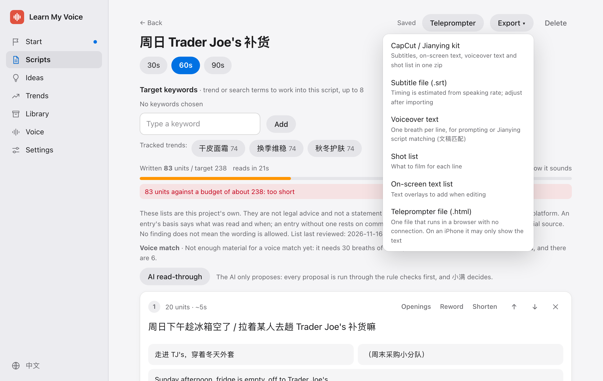

# Learn-My-Voice

[English](README.md) | **简体中文**

一个在自己电脑上运行的中英双语脚本工作台，给小红书和其他短视频创作者用。
它从你以前亲手写的脚本里学习你平时怎么说话，照着你的口吻写新脚本、帮你检查，再把结果交给剪映（国际版叫 CapCut）去剪辑。

它有两种用法：一种是桌面应用，macOS 和 Windows 都有安装包，装上就能用，不需要别的东西；另一种是压缩包，只需要电脑上有 Python。在 macOS 上，Python 包含在苹果免费的「命令行工具」里；如果还没装，压缩包里的启动文件会提示你安装。


*截图里用的是虚构的示例数据。*

## 目前的状态

这是早期版本，使用前请先看这一段。

| 部分 | 状态 |
| :--- | :--- |
| 脚本编辑、检查、提词器、素材库、导出 | 可以用。有自动化测试，也在真实浏览器里跑过（macOS 上的无界面 Chrome）。 |
| AI 功能（写初稿、学习声音、选题建议） | 测试里用的是模拟的模型回复。真实模型写出来的质量还没有评估过。 |
| 引导设置、声音档案确认、从改稿中学习 | 有自动化测试。其中用到 AI 的部分和上一行一样，只用模拟回复测试过。 |
| 本机视频转写 | 只支持 Apple 芯片的 Mac，macOS 14 或更新。目前只在一台 Mac 上安装并用过。机器转写会有错字，尤其是句尾语气词，所以转写的文字要你确认以后，才会用来学说话习惯。 |
| 热点关键词 | 粘贴、排序和关键词检查可以用，有自动化测试，也在无界面 Chrome 里跑过。排序的权重是凭经验定的，**还没有**用真实结果校准过。让能联网的 AI 查热词这一步，只用模拟回复测试过。从表格导入是新功能，只用自己编的文件测试过：新红、千瓜、灰豚真实导出的文件，以及 Excel、WPS、Numbers 保存的工作簿，都**还没有**试过。 |
| 一句话找选题 | 新功能。在「选题建议」里写一句或说一句，先查最近的热词，再给选题。有自动化测试，页面和服务也一起在无界面 Chrome 里跑过，用的是模拟的 AI 回复。用 Gemini 或 OpenAI 密钥联网查热词这一步，是照着这两家的文档写的，**还没有**真的连过任何一家。说话输入是用一台 Mac 上的 Whisper 测的，用一段声音代替了麦克风；真实的麦克风**还没有**试过。 |
| 剪映 / CapCut | 导出的是可以导入的标准文件。维护者**还没有**在剪映或 CapCut 里实际验证过导入。目前不会直接生成剪映草稿。 |
| MCP 服务 | 在协议层面测试过（标准输入输出上的 JSON-RPC）。**还没有**和 ChatGPT、Codex 或 Claude Desktop 实际连通验证。 |
| 系统 | 在 macOS、Python 3.9 上开发。还没有人在 Windows 或 Linux 上实际用过。自动化测试在 GitHub 的机器上跑三个系统，各用 Python 3.9、3.14 和 3.15：截至 2026 年 11 月 17 日，三个系统都通过了，压缩包在三个系统上也都能用启动文件打开。每个候选版本的发布说明里，会写这个版本在每个系统上测出来的结果。 |
| 桌面应用 | 新功能。macOS（Apple 芯片和 Intel 芯片）和 64 位 Windows 的安装包都在 GitHub 的机器上生成；每个安装包都要在那里装一遍，把应用打开、用一遍、再关掉，通过了才会附在候选版本里。**还没有人亲手装过。**安装包没有签名，所以第一次要告诉系统「允许运行」。在桌面应用里转写视频，需要 Apple 芯片的 Mac，并且装有苹果免费的「命令行工具」；这条路只在一台 Mac 上、用源代码启动工作台的方式试过，**还没有**在桌面应用里试过。麦克风也还没有试过，目前没有 Linux 版。安装包附上之前，装好的应用要在自己的窗口里自己走一遍：打开一篇脚本、导出、点一个外部链接、再把脚本删掉；每次试出来的结果以 `desktop-<系统>-trial.txt` 附在候选版本里。 |

## 快速开始

候选版本在仓库的
[Releases 页面](https://github.com/LetsLearntocodeforfun/Learn-My-Voice/releases)。每个版本都有两种用法。

**用桌面应用。** 不需要别的东西，Python 已经装在里面。按你的电脑下载对应的安装包：

| 系统 | 文件 | 第一次打开 |
| :--- | :--- | :--- |
| macOS，Apple 芯片 | `learn-my-voice-<版本号>-macos-arm64.dmg` | 打开 `.dmg`，把 Learn My Voice 拖到「应用程序」。第一次打开会被拦住：请到「系统设置」→「隐私与安全性」，往下找到「仍要打开」。 |
| macOS，Intel 芯片 | `learn-my-voice-<版本号>-macos-x64.dmg` | 同上。 |
| Windows，64 位 | `learn-my-voice-<版本号>-windows-x64-setup.exe` | 运行它。出现「Windows 已保护你的电脑」时，点「更多信息」，再点「仍要运行」。 |

系统会拦，是因为安装包没有签名：这个项目没有付费的证书。只需要这样做一次。如果电脑是公司或学校管理的，可能根本不允许运行；这种情况下，下面的压缩包也许还可以用，因为它用的是系统里已有的 Python。Mac 用的是哪种芯片，可以在苹果菜单的「关于本机」里看到。应用会在自己的窗口里打开。它保存的内容（脚本、素材库、设置）放在系统的应用数据文件夹里，所以装新版本不会丢。导出的文件会放进你的「下载」文件夹，应用会告诉你放在哪里；外部链接会在你的浏览器里打开。在桌面应用里转写视频，需要 Apple 芯片的 Mac 和苹果免费的「命令行工具」，没装的话应用会告诉你怎么装。还没有人亲手装过：每个候选版本的发布说明里，会写 GitHub 的机器安装并使用这个版本时测出来的结果。

**用压缩包。** 需要 Python 3.9 或更新版本，不用安装任何依赖。下载
`learn-my-voice-<版本号>.zip`，解压后这样启动：

| 系统 | 启动方法 |
| :--- | :--- |
| macOS | 双击 `启动工作台.command`（或 `Start Learn My Voice.command`）。第一次 macOS 会拦住：macOS 15 或更新的版本，请打开「系统设置」→「隐私与安全性」，往下找到「仍要打开」；更早的版本，右键点这个文件，选择「打开」。 |
| Windows | 双击 `Start Learn My Voice.bat` |
| Linux | 在终端里运行 `sh start-learn-my-voice.sh` |

Windows 和 Linux 的启动文件是新加的，还没有人实际用过。每个候选版本的发布说明里，会写这个版本在 GitHub
的机器上、在每个系统上能不能启动，并附上压缩包的 SHA-256。

**从源代码运行。**

```bash
git clone https://github.com/LetsLearntocodeforfun/Learn-My-Voice.git
cd Learn-My-Voice
python3 -m studio.server
```

用压缩包或源代码运行时，工作台会在浏览器里打开，地址是 `http://127.0.0.1:8765`。「设置」页的最下面会显示正在运行的是哪个版本。

界面默认是中文。点左下角的 **English** 可以切换成英文。
界面会跟随电脑的浅色或深色外观；在 **设置 → 外观** 里可以选浅色、深色，也可以换强调色。
语言和外观会记住，下次打开桌面版也一样。

## 头十分钟怎么用

1. 第一次打开会进入**开始**页。第一步：怎么称呼你、主要拍什么、你坚决不说的话。
2. 第二步：放素材。以前亲手写的脚本（`.txt`、`.md`、`.docx`）、字幕文件（`.srt`、`.vtt`），或者直接放视频（只支持 Apple 芯片的 Mac）。非商单素材至少 3 篇，5 篇以上更好。
3. 第三步：选择 AI 的来源（见下一节，默认的方式不需要密钥），让它读你的素材、提出一份声音档案。提议里的每一条都会回到你的素材里核对。你逐条决定，然后点采用。
4. 第四步：写第一篇脚本。脚本下面会列出这篇初稿参照了你的哪些素材。
5. **素材库**：有数据的话填上播放、点赞、收藏、评论；商单请勾选「商单」。
6. **热点**（可选）：把你在小红书看到的热词贴进来，让它结合你自己的数据排个先后。
7. **选题建议**：写一句这次想拍什么，或者直接说一句，也可以什么都不填，然后点「找选题」。用的是 Gemini 或 OpenAI 密钥的话，工作台会先联网查最近的热词，再给选题。挑一个选题或热词，直接写初稿。
8. **我的脚本**：修改初稿，用提词器念，再导出剪映素材包。
9. 视频发出去以后：在这篇脚本上点**标记为已发布**，有数据了再填上。脚本会带着数据进素材库，下次找选题、排热点就能用上它的表现。

在采用你自己的声音档案之前，工作台用的是自带的*示例*声音档案（一个虚构的博主），页面上会有提示。

## AI 从哪里来

| 方式 | 需要什么 | 你的文字会发到哪里 |
| :--- | :--- | :--- |
| **ChatGPT 订阅（复制粘贴）**，默认 | 一个 ChatGPT 账号，或任何聊天类 AI。不需要 API 密钥。 | 你粘贴进去的那个聊天窗口 |
| **MCP** | 支持 MCP 的 AI 应用（见下文） | 那个应用的服务商 |
| **Google Gemini** 或 **OpenAI** 的 API | API 密钥 | Google 或 OpenAI |
| **本地模型** | 在同一台电脑上运行的 Ollama 或 LM Studio | 不会离开这台电脑 |

### 用订阅复制粘贴

ChatGPT 订阅不包含 API，所以工作台没办法直接调用它。在这个模式下，每次需要 AI 时，工作台会准备好一段提示词：
把它粘贴给 ChatGPT，再把回复粘贴回来。提示词里包含你的声音档案和相关的脚本内容。

查热词永远是用这种方式，不管上面选的是哪种 AI，因为它需要一个当时就能联网搜索的 AI。那段提示词里放的是你的视频标题，不是脚本正文。


### 本地模型

先打开 Ollama 或 LM Studio 并下载好模型，再到「设置」里选择**本地模型**。工作台会列出已经安装的模型。只接受这台电脑上的地址。
请检查本地模型的上下文长度设置：提示词比较长（经常超过一万个字符），默认值太小的话会被截断。

### MCP 服务

`run_mcp.py` 是一个通过标准输入输出通信的 MCP（Model Context Protocol）服务。接上以后，由 AI 应用负责写，
工作台负责提供你的声音档案、以前的脚本、检查规则和保存。通过 MCP 保存的脚本会出现在工作台里。

提供的工具：`get_script_brief`、`save_script`、`update_script`、`check_script`、`list_scripts`、`get_script`、
`get_voice_profile`、`list_library`、`get_voice_learning_brief`、`save_voice_profile`、
`get_topic_ideas_brief`、`save_topic_ideas`、`export_jianying_kit`、`list_trends`、`add_trend_keywords`。

下面的配置方法来自各家截至 2026 年 11 月的官方文档，维护者都还没有实际验证过。
路径请用绝对路径；路径里没有空格可以避免引号问题。

「设置」页会显示 Codex 的配置，里面是正在运行的这个工作台的真实路径：它用的 Python、它的 `run_mcp.py`，
以及 `--data-dir` 后面它正在用的数据文件夹。路径请从那里复制。桌面应用尤其要这样做：它的 Python 和脚本都在应用里面，
数据则在系统的应用数据文件夹里，`--data-dir` 指的就是那个文件夹。不写 `--data-dir` 时，服务用的是 `run_mcp.py`
旁边的 `data` 文件夹，这对压缩包和源代码是对的。

**Codex（用 ChatGPT 订阅登录）**：在 `~/.codex/config.toml` 里加上：

```toml
[mcp_servers.learn_my_voice]
command = "python3"
args = ["/absolute/path/to/Learn-My-Voice/run_mcp.py"]
```

「设置」页面里会显示填好真实路径的这段配置。

**ChatGPT 网页版**：ChatGPT 可以添加自定义 MCP 服务，但服务必须能通过 HTTP 访问，或者通过 OpenAI 的 Secure MCP Tunnel 连接；
它不能自己启动本地程序。Tunnel 客户端可以启动本服务：

```bash
tunnel-client init --sample sample_mcp_stdio_local --profile learn-my-voice \
  --tunnel-id <你的 tunnel id> \
  --mcp-command "python3 /absolute/path/to/Learn-My-Voice/run_mcp.py"
tunnel-client run --profile learn-my-voice
```

按照 OpenAI 的说明，Tunnel 本身需要在 OpenAI Platform 上申请一个 tunnel id 和一个 API 密钥。
详见 [Add custom MCP server](https://developers.openai.com/api/docs/guides/custom-mcp-server) 和
[Secure MCP Tunnel](https://developers.openai.com/api/docs/guides/secure-mcp-tunnels)。

**Claude Desktop 和其他支持 stdio 的客户端**：

```json
{ "mcpServers": { "learn-my-voice": { "command": "python3", "args": ["/absolute/path/to/Learn-My-Voice/run_mcp.py"] } } }
```

然后在聊天里说，比如：*「用 Learn My Voice 帮我写一个 60 秒的脚本，讲我们周末去 Costco 补货。」*

## 功能

- **脚本编辑**：一句话一张卡片，可以填画面和花字，实时显示字数和大概要念多久，自动保存。
- **实时检查**（中英文提示）：一口气念不完的长句、你从来不说的词、营销号套话、翻译腔、可能违规的广告用语，以及全篇长度和目标时长是否匹配。这些是规则不是 AI，所以即时、每次结果一致。
- **引导设置**（「开始」页）：一共五步：关于你、你的素材、你的声音、第一篇脚本、越用越像你。每一步都写明什么会离开这台电脑、什么不会。
- **素材**：亲手写的脚本（`.txt`、`.md`、`.docx`）、字幕文件（`.srt`、`.vtt`），以及在 Apple 芯片的 Mac 上直接转写的视频。字幕和视频带时间，所以语速是从里面量出来的。
- **学习声音**：AI 读你的素材，提出一份声音档案。它说你会说的每一句话，程序都会回到你的素材里去找。确认页会告诉你哪些找到了、哪些没找到，还有哪些它想禁用、其实你说过。你点了采用，这份档案才会生效。素材够 30 口气以后，每口气的字数范围是程序量出来的，不是模型猜的。商单脚本不会混进核心档案。旧档案会留着，可以恢复。
- **写初稿**：每次都会把你自己表现最好的脚本当作范例一起给 AI。每篇脚本可以设最多 8 个目标关键词：设了以后，会优先拿你讲过相关话题的脚本当范例，编辑页也会显示每个关键词有没有出现在口播里，或者 AI 写的备选标题、正文、话题里。AI 写初稿时一起写的备选标题、封面文字、正文和话题会显示在脚本下面，可以看、可以复制。
- **从改稿中学习**：每篇 AI 初稿下面都会列出它的提示词里放了你的哪几篇素材。你改过以后，工作台会列出你改了哪些字（只算真正改了字的地方），你可以让它记住某个改法。记住的改法会放进以后每次写稿的提示词里；在不止一篇脚本里删掉过的说法，会问你要不要加入「坚决不说的话」。
- **选题建议**：按互动量给以前的视频排名，建议接下来拍什么。每条建议必须引用你自己的视频；引用的标题如果对不上，会被去掉。正在跟踪的热词会作为第二个参考一起给 AI，建议里只能提到确实在跟踪的热词。
- **一句话找选题**：在「选题建议」页（连接 AI 以后，首页也有），写一句这次想拍什么；装了本机转写的 Mac 上也可以直接说。用的是 Gemini 或 OpenAI 密钥的话，工作台会先让这个服务联网查你内容方向里最近的热词，只留下带来源链接的，标成「未核实」，再让它按你这句话给选题。用本地模型或复制粘贴模式时，同样的两步可以手动做。页面上会列出选题、查到的热词和来源，以及查的时候引用的网页。其中一步失败了，另一步的结果照样显示，以前保存的选题也还在。
- **热点关键词**：把你看到的热词贴进来（后面可以带热度数字），或者导入数据分析工具导出的关键词表（`.csv`、`.tsv`、`.txt`、`.xlsx`）。导入文件时，工作台会先告诉你它把哪一列当成关键词、哪一列当成数字，前几行读出来是什么样；列可以改，点「导入」之前不会保存任何东西。工作台按「有多热、多新」和「你自己拍相关内容的表现」给它们排序，两边各占多少由你选。排序是算出来的，不是 AI。和你的声音档案冲突的词会标出来，不会出现在推荐里。也可以让能联网的聊天 AI 帮你查（通过复制粘贴对话框或 MCP）：查到的词必须带来源链接，并且会标明「未核实」。
- **提词器**：全屏，可调速度和字号。
- **标记为已发布**：在工作台里写的脚本，拍完发出去以后，可以带着发布日期、笔记链接（可不填，只当文字保存，不会去打开）和数据进素材库，成为一条素材。数据马上计入所有用到你自己表现的地方。数据是哪天看的会记在旁边，并显示是发布后第几天；不折算，也不预估。它的文字先不算你自己的说法，要等你确认，或者附上这条视频的字幕文件或转写，因为稿子可能是从 AI 初稿改来的。页面会告诉你还有几句是 AI 写的原样，这是程序数出来的。还是 AI 原句的开场，不会列进你自己的开场里。
- **用词提示的词表**（设置）：检查时会提示可能有问题的广告用词，并写明每一条的依据：读过的《广告法》条文，或者说明没有核对过出处。另有一类「只是提示」，标出念出来像书面稿的说法，从不算作问题。每一条都可以关掉，也可以加你自己的说法。这份词表是本项目自己整理的，不是法律意见，也不代表小红书的规则；没有提示，不等于这样说就没问题。
- **导出**：剪映素材包、字幕 `.srt`、口播文稿、拍摄清单、花字清单。


## 剪映 / CapCut

在脚本页点 **导出 → 剪映素材包**，会下载一个压缩包：

| 文件 | 用途 |
| :--- | :--- |
| `口播文稿.txt` | 一口气一行。粘贴到剪映的「文稿匹配」里，字幕会和你的实际录音对齐。 |
| `字幕.srt` | 可以导入的字幕文件。**时间是按语速估算的**，不是按录音，导入后需要微调。 |
| `花字.srt` | 花字，位置在对应那句话附近。 |
| `拍摄清单.txt` | 每一句对应要拍的画面。 |
| `使用说明.txt` | 导入步骤。 |

把界面切换成英文再导出，文件名和说明就是英文的。



目前还做不到的：直接生成一个剪映草稿（素材和文字已经排在时间线上），以及根据你的实际录音给字幕打时间。
剪映的草稿格式没有公开文档，新版本里也无法直接读取，主要的开源生成工具对 macOS 上生成的草稿也有限制说明，
所以这一步需要先在真实安装的剪映上测试。

## 数据和隐私

- 所有内容都保存在项目文件夹里的 `data/`：脚本、素材库、你在「开始」里填的资料、声音档案、设置。这个文件夹不会被 git 提交；在 macOS 和 Linux 上，电脑上的其他账号也打不开它。
- API 密钥保存在 `data/config.json`，只有本人可读，也不会再传回浏览器。
- 网页服务只监听 `127.0.0.1`，拒绝 Host 不对的请求，也拒绝其他网站发来的写入请求。
- 使用 AI 时，会把你在「开始」里填的资料、你的声音档案、想法和部分以前的脚本发给你选择的那个 AI。用本地模型的话，内容不会离开这台电脑。
- 放进来转写的视频会先复制到 `data/uploads/`，在这台 Mac 上转写。转写一结束，不管成功还是失败，这份副本都会删除，只留下文字和时间。负责转写的程序是在 macOS 的规则下启动的，这些规则不让它们联网；规则没法生效的时候，就不会转写。
- 安装本机转写时，会从 pypi.org 下载组件、从 huggingface.co 下载一个语音模型，一共约 2 GB，装在项目文件夹的 `local_tools/whisper/` 里。这个过程不会发送任何关于你的内容。
- 播放、点赞、收藏、评论都是手动填写的，不会从任何平台抓取数据。
- 热词要么是你自己贴进来的，要么是从你选的文件里导入的，要么是能联网的 AI 查到的。导入的文件只发给这台电脑上的工作台（`127.0.0.1`），读完就不保留，不经过任何 AI。AI 查热词有两种：可以是你自己用复制粘贴去问的那个 AI；也可以是在「选题建议」里用 Gemini 或 OpenAI 密钥、并且勾了联网查热词时，那个服务自带的联网搜索。工作台自己不打开任何网页，也不从任何平台抓数据。查热词的提示词里有你在「开始」里填的内容方向、最多 20 条非商单视频的标题、你这次写的或说的那句话和已经在跟踪的热词；不包含脚本正文、你的名字，也不包含声音档案里的任何内容。之后想选题的提示词是另一次请求，发送时不联网。
- 说的那句话在浏览器里录下来，发给这台电脑上的工作台（`127.0.0.1`），由本机转写变成文字，录音随后删除。不使用浏览器自带的语音识别。文字先出现在输入框里；点「找选题」之前，不会发给任何 AI。

## 项目结构

| 路径 | 内容 |
| :--- | :--- |
| `studio/server.py`、`studio/web/` | 本地网页服务和界面 |
| `studio/guardrails.py`、`studio/lexicon.json`、`studio/checks.py` | 规则检查和中英文提示 |
| `studio/pipeline.py`、`studio/llm.py` | 生成提示词、校验回复、对接模型 |
| `studio/corpus.py` | 读取脚本、统计、表现排名 |
| `studio/creator.py`、`studio/setup.py` | 你在「开始」里填的资料，以及设置进行到哪一步 |
| `studio/evidence.py` | 回到你的素材里核对 AI 提出的声音档案 |
| `studio/learning.py` | 比较 AI 的初稿和你改过的版本 |
| `studio/timing.py` | 读取字幕文件，按时间量语速 |
| `studio/transcribe.py`、`studio/whisper_worker.py`、`studio/jobs.py` | 本机转写和它的后台任务 |
| `studio/trends.py` | 读取粘贴的热词、结合你自己的数据打分、检查关键词有没有用上 |
| `studio/keyword_import.py` | 从 `.csv`、`.tsv`、`.txt`、`.xlsx` 文件里读关键词表，并限制一个文件最多能让程序做多少事 |
| `studio/exports.py` | 文本导出、`.srt`、剪映素材包 |
| `studio/mcp_server.py`、`run_mcp.py` | MCP 服务 |
| `studio/buildinfo.py` | 正在运行的是哪个版本：安装包里的版本号，或者「从源代码运行」 |
| `prompts/` | 提示词原文。程序直接读取其中的 02、04、06、07，修改这些文件就会改变行为。 |
| `.github/workflows/tests.yml` | 每次推送都在 macOS、Windows 和 Linux 上跑测试 |
| `.github/workflows/release-candidate.yml` | 推送到 `beta/...` 分支时：跑测试、打包、在三个系统上试用、发布成预发布版本 |
| `tools/build_release.py`、`tools/try_release.py`、`tools/run_tests.py` | 上面两个流程运行的脚本，在自己的电脑上也一样能跑。不在安装包里。 |
| `SYSTEM_DESIGN.md` | 最初的、更大的设计方案，其中一部分还没有实现。 |

提示词会收到你在「开始」里填的资料（称呼、内容方向、常一起出镜的人、坚决不说的话），不再假定是某一位具体的博主。它们是为中文的小红书视频脚本写的。

## 开发

```bash
python3 -m unittest discover -t . -s tests        # 全部测试，无依赖
python3 tools/build_release.py build              # 按最近一次提交打出安装包，放在 dist/
python3 tools/try_release.py dist/learn-my-voice-*.zip    # 解压、用启动文件启动、试用、关闭
python3 -m studio.guardrails tests/fixtures/worked_example_script.json --dna schemas/voice_dna.example.json
```

## 已知的限制

- 广告违规词表只是为这个项目收集的起点，没有对照平台或法规的最新要求核实过，不构成法律意见。
- 语速没法从文字里学出来。素材库里带时间的素材（字幕文件或转写的视频）满一分钟以后，语速是量出来的；在那之前用默认值，或者用你自己填的数字。
- 本机转写只支持 Apple 芯片的 Mac、macOS 14 或更新，并且要用苹果命令行工具自带的 Python（3.9）。目前只在一台 Mac 上安装并用过。Whisper 会把一些句尾语气词写错：用合成语音测试时，它把「嘛」写成「吗」、「呗」写成「背」、「喔」写成「哦」、「呐」写成「呢」。所以转写的文字要你看过、确认以后，才会用来学说话习惯。
- 有数据的视频太少时，选题建议不太可靠，页面上会有提示。
- 热词的分数只是参考，不是测量结果。权重和「每 14 天减半」都是凭经验定的，还没有用真实结果校准过；热度数字填的是什么就是什么。判断一条视频和热词相不相关，靠的是有没有相同的字词，所以换了说法讲同一个话题的视频可能对不上。
- 从表格导入时，只读工作簿的第一张表，最多 5000 行、50 列，一次最多导入 200 个关键词。哪一列是关键词，是根据表头名字和内容猜的；它认的表头（关键词、热词、搜索指数等）是在没见过真实导出文件的情况下定的，所以请看一眼预览。旧版 `.xls` 和加了密码的工作簿读不了。
- AI 查到的热词可不可靠，取决于它引用的那个网页。工作台只要求有网页链接，并且会去掉来源日期超过 30 天的词；它不会打开网页，所以没法确认网页上是不是真的那么写。这些词会标着「未核实」，除非你自己把同一个词贴进来。
- 「选题建议」里自带的联网查热词，是照着 Google 和 OpenAI 在 2026 年 11 月 16 日的文档写的，还没有真的连过任何一家。对 Gemini 用的是 Interactions API，和工作台其他地方调用的不是同一个接口。OpenAI 要求把联网搜索引用的网页显示成可以点的链接，页面上是这样做的。Google 会返回一段用来显示「搜索建议」的 HTML，并在服务条款里写了使用要求；工作台没有显示这一段，那些条款也还没有读过。
- 说话输入要用本机转写，所以只有能转写视频的电脑上才能用。Whisper 会听错：用合成的中文语音测试时，它把「秋冬」写成了「邱中」。文字会先显示在输入框里，发出去之前可以改。
- 商单 Brief 处理和二次审稿在 `prompts/` 和 `SYSTEM_DESIGN.md` 里有设计，但还没有实现。

## 许可

MIT，见 [LICENSE](LICENSE)。
