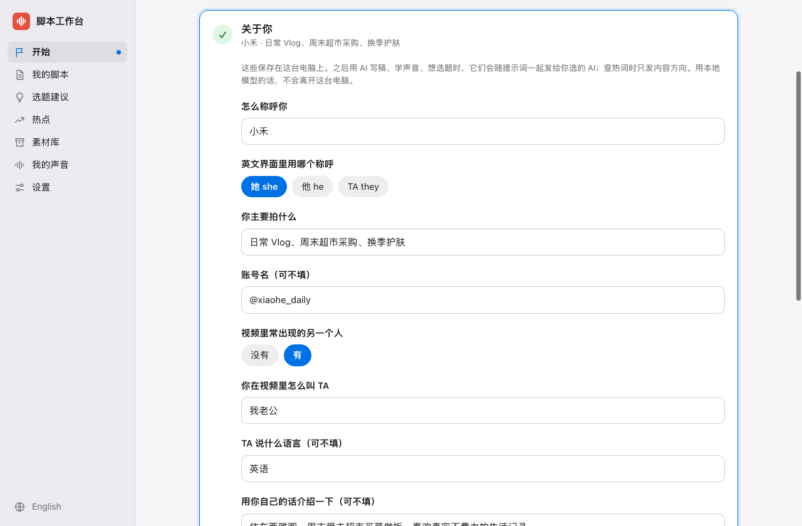
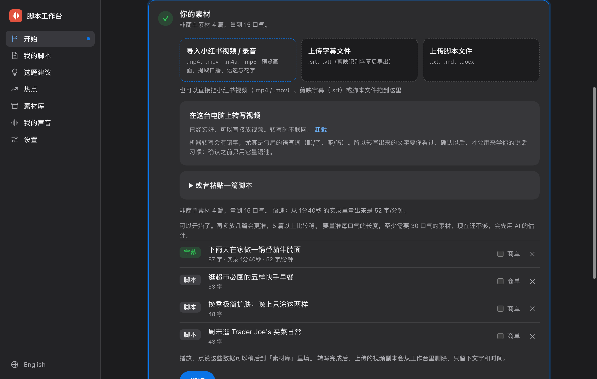
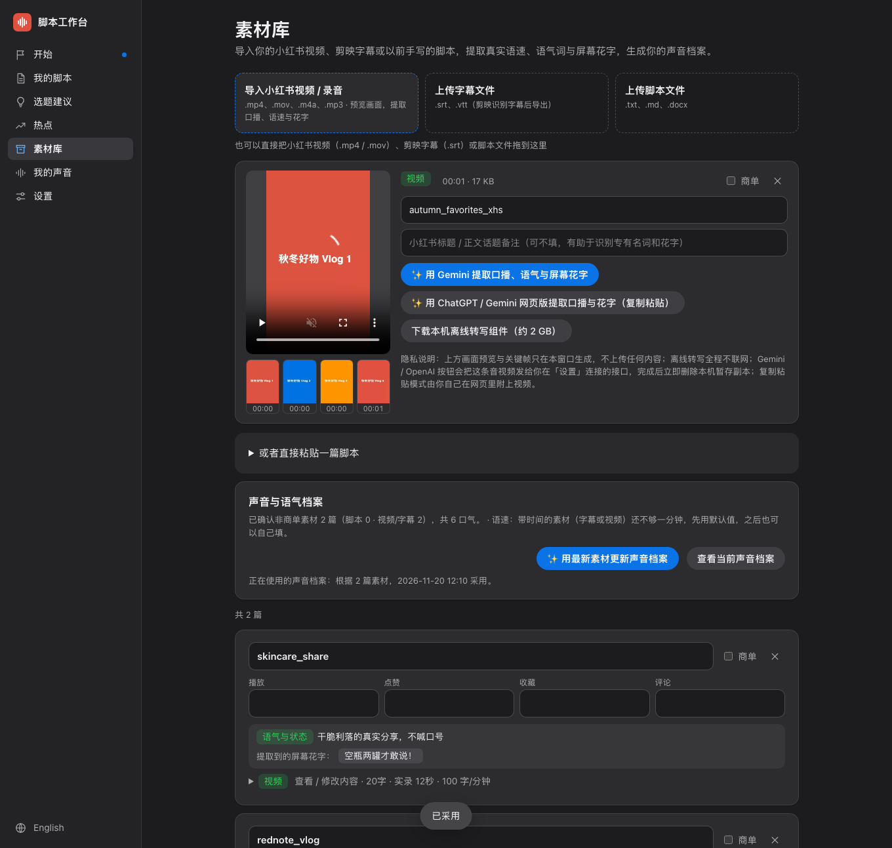
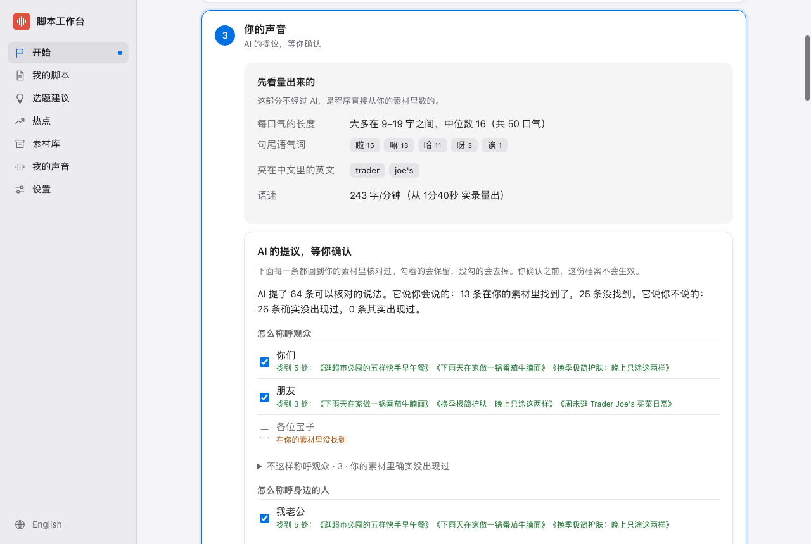
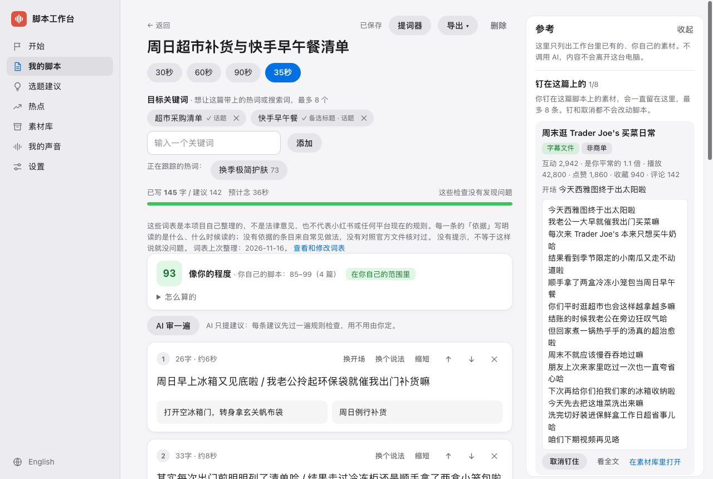
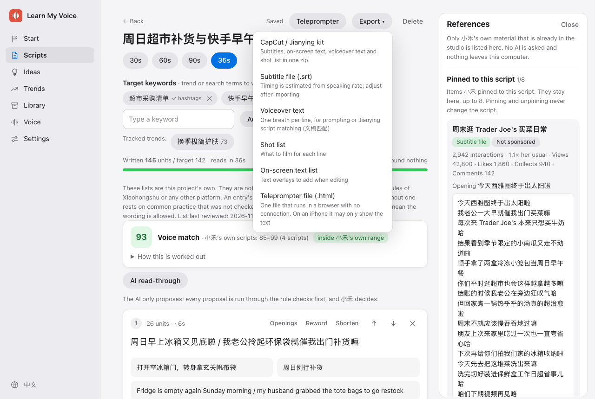

# Quick Start Guide

**English** | [简体中文](QUICKSTART.zh-CN.md) · [Full README](../README.md)

**Learn-My-Voice** is a private, bilingual (中文 / English) script studio that runs on your own computer for RedNote (`小红书`) and short-video creators. Give it 3 to 5 of your real past videos, subtitle files, or scripts, and in about five minutes you will have a verified **Voice Profile** and a breath-by-breath script ready for filming and **剪映 (Jianying) / CapCut**.

> **Before you start:** Have **3 to 5 non-sponsored items** from past videos ready — RedNote video/audio files (`.mp4`, `.mov`, `.m4a`, `.mp3`, `.wav`), CapCut / 剪映 subtitle files (`.srt`, `.vtt`), or written scripts (`.txt`, `.md`, `.docx`). Notice that this is an early beta release: review AI drafts and rule hints with your own judgment before posting.

---

## 1. Download & Open the Studio

Download the latest release from the [GitHub Releases page](https://github.com/LetsLearntocodeforfun/Learn-My-Voice/releases). Choose whichever form fits your computer:

### Option A: Desktop App (Recommended — Nothing Else to Install)

Python is bundled inside the app, and your scripts, library, and Voice Profile stay in your computer's standard application-data folder across updates.

| Computer | File to download | First-time open tip |
| :--- | :--- | :--- |
| **Mac (Apple chip: M1–M5)** | `learn-my-voice-<version>-macos-arm64.dmg` | Open the `.dmg` and drag **Learn My Voice** to **Applications**. The first time you open it, macOS blocks it because this open-source build is unsigned: open **System Settings → Privacy & Security**, scroll down, and click **Open Anyway**. |
| **Mac (Intel chip)** | `learn-my-voice-<version>-macos-x64.dmg` | Same steps as above. *(Check **Apple menu → About This Mac** if you are unsure which chip your Mac has.)* |
| **Windows (64-bit)** | `learn-my-voice-<version>-windows-x64-setup.exe` | Run the installer. If **Windows protected your PC** appears, click **More info**, then **Run anyway** (needed once). |

### Option B: Portable `.zip` Launcher (Uses Your Computer's Python)

If you prefer a portable folder (or use a work/school computer that blocks unsigned installers) and have **Python 3.9+**, download and unzip `learn-my-voice-<version>.zip`:

| Computer | How to launch |
| :--- | :--- |
| **macOS** | Double-click `启动工作台.command` or `Start Learn My Voice.command`. *(First time only: on macOS 15+, allow it in **System Settings → Privacy & Security → Open Anyway**; on older macOS, right-click the file and choose **Open**.)* |
| **Windows** | Double-click `Start Learn My Voice.bat`. |
| **Linux** | Run `sh start-learn-my-voice.sh` in a terminal. |

> **Important for `.zip` users — do not bookmark `127.0.0.1`:** Every time the `.zip` launcher starts, it generates a fresh local security token so other programs or accounts on the computer cannot read your scripts, and opens the studio automatically in your browser. Always start from the launcher file (or copy the **安全访问链接 / Launch link** printed in its terminal window) rather than opening an old bookmark. *(Desktop App users never need to think about this — the app opens in its own window automatically.)*

### Language & Appearance
- **中文 / English toggle:** The studio starts in Chinese. Click **English** at the bottom-left of the sidebar anytime to switch languages (and **中文** to switch back).
- **Light, dark & accent colour:** Go to **设置 / Settings → 外观 / Appearance** to pick **Auto**, **Light**, or **Dark** mode and your preferred accent colour.

---

## 2. Your First 5 Minutes (`开始 / Start`)

The first time you open the app, **开始 / Start** walks you through five clear steps.

### Step 1 — About You (`关于你`)

Fill in who the studio is writing for, then click **Save and continue (`保存并继续`)**:

1. **Name (`怎么称呼你`)** & **Main kinds of content (`你主要拍什么`)** — e.g. `日常 Vlog, 周末超市采购, 换季护肤`.
2. **On-camera partner (`视频里常出现的另一个人`, optional)** — if a spouse, partner, family member, or roommate often appears in your videos, select **Yes (`有`)**, enter what you call them on camera (e.g. `我老公`), and their language (e.g. `英语 / English`). Every script card will then include a parallel English line so you can brainstorm and review together!
3. **Phrases never to be used (`你坚决不说的话`)** — put one cringe cliché per line (e.g. `姐妹们谁懂啊`, `绝绝子`, `按头安利`). Instant rule checks will flag any spoken line in red if one ever sneaks in.

*Screenshots in this guide show a fictional creator ("小禾") and invented sample scripts.*

---

### Step 2 — Add Your Material (`你的素材` / `素材库`)

Give the studio **at least 3 non-sponsored items** (5 or more is even steadier) so it can measure your real rhythm and vocabulary. If you include an old brand deal, tick **Sponsored (`商单`)** next to it so brand copy never pollutes your core voice.

You have **three ways** to bring in your real voice (both here on Step 2 and anytime in **素材库 / Library**):

1. **RedNote Videos & Audio (`导入小红书视频 / 录音` / `上传视频或录音` — `.mp4`, `.mov`, `.m4a`, `.mp3`, `.wav`)**
   - Preview your video visually inside the studio (with inline playback and visual keyframes), then pick how to turn it into text:
     - **Offline on Apple Silicon Mac:** Click **Download and install (`下载并安装`)** once (~2 GB speech model). After that, transcription runs 100% offline under macOS network-blocking rules, and the temporary video copy is deleted as soon as transcription finishes.
     - **Gemini / OpenAI API:** With a **Gemini** key, analyze spoken lines, tone, and on-screen callouts (`花字`) together; or transcribe audio via **OpenAI**.
     - **Zero-Key ChatGPT / Gemini Copy-Paste:** Use the prepared video analysis prompt with your normal ChatGPT or Gemini chat — no API key required.
   - **Play & confirm:** Machine speech-to-text often confuses Chinese sentence-final particles (`啦/了`, `嘛/吗`). Play back the clip, fix any typos, and click **`我看过了，文字没问题` (`The text has been read and is right`)**. Until you confirm it, a transcript counts toward speaking rate (`字/分钟`) only and will not teach wrong words into your profile.
2. **CapCut / Jianying Subtitles (`上传字幕文件` — `.srt`, `.vtt`)**
   - Works on **every Mac and Windows PC** with zero setup! Run **识别字幕 (Auto-captions)** in 剪映 / CapCut, export `.srt`, and upload it here. Because `.srt` carries timestamps, once you have at least 1 minute of timed material the studio automatically measures your exact speaking rate (`字/分钟`).
3. **Past Written Scripts (`上传脚本文件` — `.txt`, `.md`, `.docx`, or paste directly)**
   - Upload or paste scripts you wrote by hand before filming.

---

### Step 3 — Learn & Verify Your Voice (`你的声音`)

First, look at **Measured first (`先看量出来的`)** at the top of Step 3: pure code (not AI) counts your breath lengths, top sentence-final particles (`啦`, `嘛`, `哈`), English words mixed in, and measured speaking rate.

Next, choose how to connect an AI in **设置 / Settings** (or right inside Step 3):

| AI Option | What you need | Where your text goes |
| :--- | :--- | :--- |
| **ChatGPT subscription (copy & paste)** *(Default)* | Any ChatGPT / Gemini / Claude chat account — **zero API key** | Only into the chat window where you paste the prompt |
| **Google Gemini** or **OpenAI** API | An API key (sealed on disk; never shown back to the browser) | Google or OpenAI API |
| **Local model (`本地模型`)** | [Ollama](https://ollama.com) or [LM Studio](https://lmstudio.ai) running on the same computer *(use a large context window, 16k+)* | **Nowhere** — stays 100% on your computer |
| **MCP Server (`run_mcp.py`)** | Codex or Claude Desktop configured via **Settings → MCP** | That app's AI provider |

Click **`✨ 让 AI 读我的素材，提出一份声音档案` (`Have the AI read the material and propose a voice profile`)**.

> **Tip for ChatGPT Copy-Paste & `.json` files:**
> When you paste the studio's prompt into ChatGPT, ChatGPT will either print a JSON block in chat **or** generate a downloadable `.json` file link. **Both work!**
> - You can **choose or drag-and-drop the `.json` file directly** into the studio dialog, **or** copy-paste the reply text (extra chat explanation around the code block, trailing commas, and macOS smart quotes are cleaned up automatically).
> - Accidentally closed the dialog while ChatGPT was still thinking? No problem — click **Import JSON reply (`导入 JSON 回复`)** right on Step 3 (or on **我的声音 / Voice**) to bring in the `.json` file or text without starting over!

#### Review with Code-Verified Receipts
Nothing the AI proposes takes effect automatically. Code checks every phrase the AI claims you use against your real material:
- **Green (`找到 N 处 / Found N times`):** Verified in your own scripts, with the exact video titles listed.
- **Orange (`在你的素材里没找到 / Not found in the material`):** Unticked by default so hallucinated habits stay out.
- **AI's summary (`AI 的概括`):** All 21 descriptive Voice DNA fields (tone, opener patterns, code-switching rules, `花字` style, etc.) are listed clearly so you can untick any note you dislike. If you untick an entry, any note describing it leaves with it automatically.

When the checklist looks right, click **`采用这份档案` (`Accept this profile`)**. *(Every earlier profile is archived on **我的声音 / Voice** and can be restored in one click.)*

---

### Step 4 — Write Your First Script (`第一篇脚本`)

1. **Spark a topic (`选题建议 / Ideas` & `热点 / Trends`):**
   - Open **选题建议 / Ideas**, type one line about what you want to film (or click **`🎙 说一句` (`Say it`)** on a Mac with local transcription), and click **`✨ 找选题` (`Find ideas`)**. Every idea cites your own best-performing past videos.
   - Optional: on **热点 / Trends**, paste trending RedNote keywords or import a `.csv` / `.tsv` / `.xlsx` sheet to rank topics by heat + how your own related videos performed.
2. **Draft & check side-by-side (`我的脚本 / Scripts`):**
   - Pick an idea (or click **`＋ 写新脚本` (`+ New script`)**), jot rough notes in Chinese or English, pick target length (`30s / 60s / 90s`) and format, and draft!
   - Each card is **one spoken sentence** (use `/` between natural breaths), paired with **Shot (`画面`)**, **On-screen text (`花字`)**, and **English meaning** for your partner.
   - Above the lines, check **Voice match (`像你的程度`)** (counted in code against your own scripts' range) and live rule checks (breath length, never-say list, clichés, and ad-law hints).
   - Click **`打开参考` (`Open references`)** on the right to keep your **Pinned (`钉在这篇上的`)** items, **What the draft saw (`初稿看到的`)**, **On the same topic (`同主题的`)**, and full-text **Library search (`搜索素材库`)** right beside your script as you write!

3. **Polish lines, read on the Teleprompter & export to 剪映 / CapCut:**
   - **Line & script helpers:** Use **`换开场` (`Openings`)**, **`换个说法` (`Reword`)**, **`缩短` (`Shorten`)**, or **`AI 审一遍` (`AI read-through`)**. Every suggestion runs through rule checks first and waits until you click **`用这句` (`Use this`)** (with 1-click **Undo**).
   - **Teleprompter (`提词器`):** Click **`提词器` (`Teleprompter`)** for a full-screen reader paced to your speaking rate (`Space` to pause/play, `↑/↓` to step by breath, `M` to mirror for teleprompter glass).
   - **1-Click CapCut / Jianying Kit (`导出 → 剪映素材包`):** Click **`导出` (`Export`) → `剪映素材包` (`CapCut / Jianying kit`)** to save one `.zip` containing:
     - `口播文稿.txt` — paste into 剪映's **文稿匹配 (Script Matching)** to align subtitles to your real recording.
     - `字幕.srt` & `花字.srt` — subtitle and callout files (estimated from your speaking rate; adjust timing after import).
     - `拍摄清单.txt` & `使用说明.txt` — shot list and import guide.

---

### Step 5 — Keeps Learning (`越用越像你`) & Backups (`备份和恢复`)

- **Learn from your edits (`我改了什么 / What changed`):** Whenever you rewrite an AI draft in your own words, open **What changed (`我改了什么`)** at the bottom of the script and click **`记住这个改法` (`Remember this change`)**. Future drafts automatically include those lessons, and phrases you delete across multiple scripts are offered for your never-say list.
- **Mark as posted (`标记为已发布`):** After your video goes live on RedNote, open the script and click **`标记为已发布` (`Mark as posted`)** to log its post date and views, likes, collects, and comments. Those numbers immediately power future **Ideas** and **Trends** rankings — while AI-written lines stay quarantined until you confirm the final spoken words or attach the posted video's `.srt` / transcript.
- **Single-file Backup & Restore (`设置 → 备份和恢复`):** Moving to a new computer or saving a milestone? Open **设置 / Settings**, scroll to **Backup and restore (`备份和恢复`)**, and click **`备份全部内容` (`Back up everything`)**. Everything you created (scripts, library, Voice Profile + history, tracked trends, remembered edits, word-list tweaks) is saved into one file.
  - *Privacy by design:* API keys are sealed to your local computer and **never** placed inside backup files, so backups are safe to keep on cloud drives. Restoring previews the file first and saves an automatic undo backup before replacing anything.

---

## 3. Quick Troubleshooting

| What happened | How to fix it in 30 seconds |
| :--- | :--- |
| **macOS says "Learn My Voice cannot be opened" / "unidentified developer"** | Open **System Settings → Privacy & Security**, scroll down to the Security section, and click **Open Anyway** (needed once for unsigned builds). |
| **Windows says "Windows protected your PC"** | Click **More info**, then click **Run anyway** (needed once). |
| **Browser says the studio was opened without its access key (`访问口令已失效` / `401`)** | You opened a bare `http://127.0.0.1:8765` bookmark or an old tab from before a restart. Double-click the `.zip` launcher again (or use the fresh **Launch link** printed in its terminal window). |
| **ChatGPT gave me a `.json` download link instead of chat text (or `ai_bad_json`)** | Download that `.json` file and **choose or drag-and-drop it directly** into the studio's reply box (or click **Import JSON reply** on Step 3 / Voice). If pasting text, make sure ChatGPT finished generating the closing `}`. |
| **Local video transcription isn't available on my computer** | On-device Whisper requires an Apple Silicon Mac (M1+, macOS 14+) with Apple's Command Line Tools (`xcode-select --install`). On Windows or Intel Macs, either use **Gemini / OpenAI / ChatGPT video ingest** or run auto-captions in **剪映 / CapCut** and upload the exported `.srt` file! |
| **Moved `data/` to a new computer and Settings says the saved API key cannot be opened** | Saved API keys are encrypted for the specific computer/account that stored them. Simply paste your API key into **Settings** once on the new machine and click **Save**. |

---

## Where to Go Next

- Read the full [README](../README.md) ([简体中文](../README.zh-CN.md)) for MCP setup snippets, privacy details, and current beta limitations.
- Found a bug or rough edge? Report it on the repository's [Issues page](https://github.com/LetsLearntocodeforfun/Learn-My-Voice/issues).
