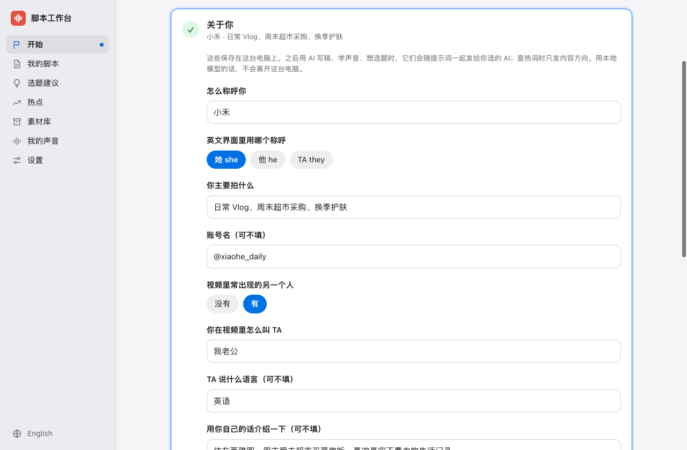
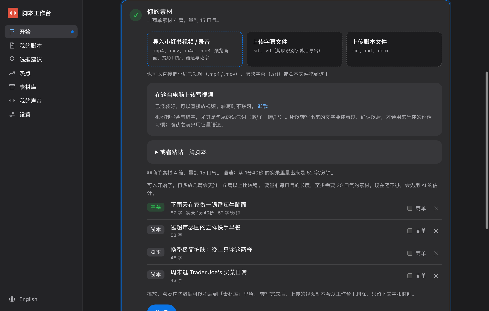
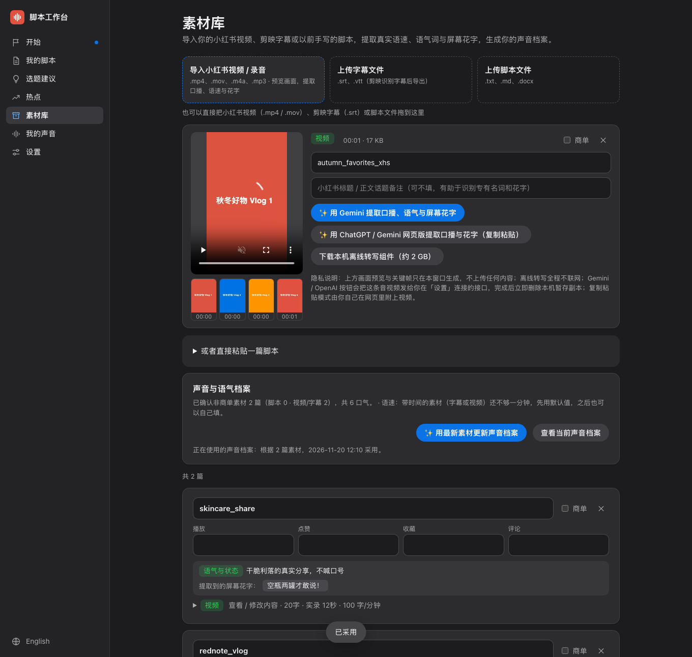
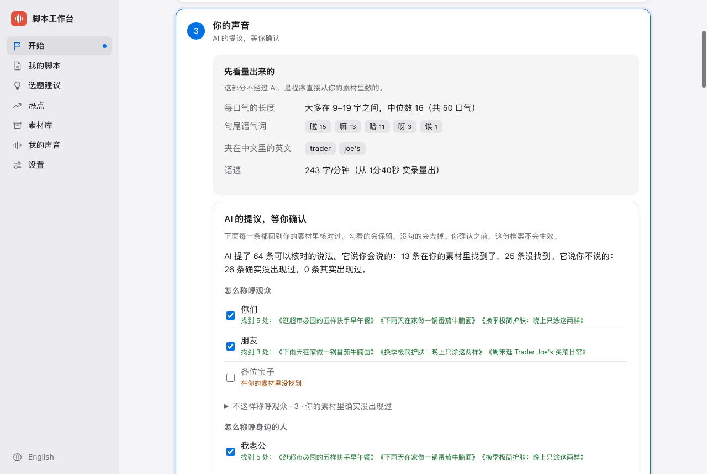
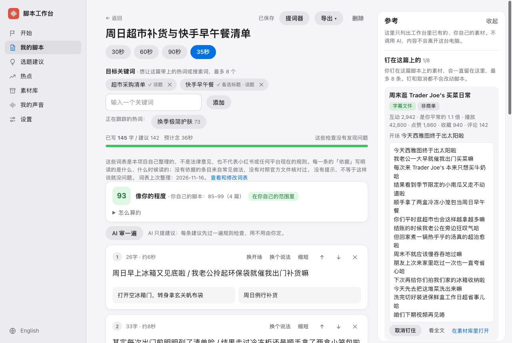
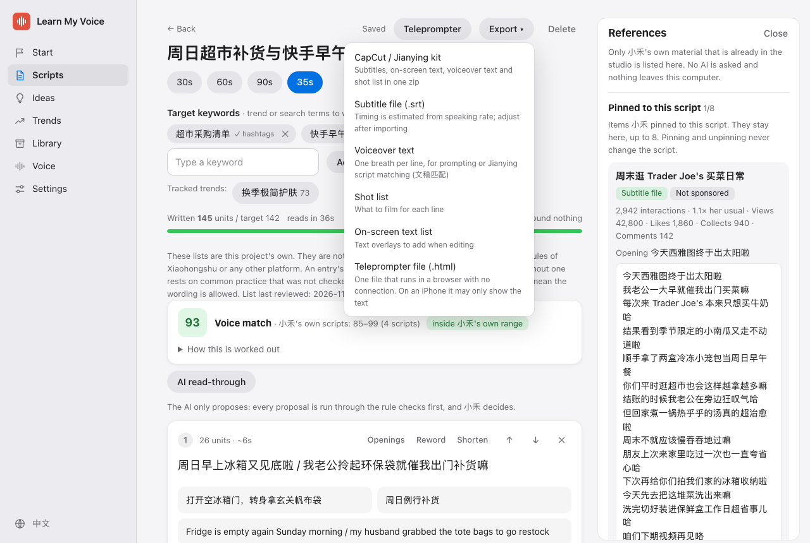

# 快速上手指南（5 分钟写出第一篇像你的脚本）

[English](QUICKSTART.md) | **简体中文** · [完整说明 README](../README.zh-CN.md)

**Learn-My-Voice（脚本工作台）** 是一个完全运行在你自己电脑上的中英双语小红书短视频脚本工具。不需要懂技术，只要放进 3–5 条你以前发过的视频、剪映字幕或手写脚本，大约五分钟就能生成一份经过核对的**专属声音档案**，写出没有「AI 味」、一口气一句的口播脚本，并一键打包交给**剪映 / CapCut**。

> **开始前准备：** 手头准备 **3–5 条非商单的过往作品**即可——可以是小红书视频或录音（`.mp4`、`.mov`、`.m4a`、`.mp3`、`.wav`）、剪映导出的字幕（`.srt`、`.vtt`），或者以前写过的脚本（`.txt`、`.md`、`.docx`）。目前工作台处于早期测试阶段（Beta），AI 初稿和广告词提示仅供辅助，发布前请按自己的判断把关。

---

## 一、下载与打开（两种方式任选）

前往项目的 [GitHub Releases 下载页](https://github.com/LetsLearntocodeforfun/Learn-My-Voice/releases)，选最适合你电脑的一种：

### 方式 A：桌面应用（最省心，推荐）

安装包里已经自带 Python，装好就能直接打开独立窗口；你写的脚本、素材库和声音档案都存在系统的应用数据目录里，以后升级新版本也不会丢。

| 电脑系统 | 下载哪个文件 | 第一次打开被系统拦住怎么办？（只需操作一次） |
| :--- | :--- | :--- |
| **Mac（苹果芯片 M1–M5）** | `learn-my-voice-<版本号>-macos-arm64.dmg` | 双击打开 `.dmg`，把 **Learn My Voice** 拖进「应用程序」。因为开源项目没有购买付费签名证书，第一次打开时若提示无法验证，请打开 **系统设置 → 隐私与安全性**，往下滑点 **仍要打开**。 |
| **Mac（Intel 芯片）** | `learn-my-voice-<版本号>-macos-x64.dmg` | 同上。*（不确定芯片型号？点屏幕左上角苹果图标 →「关于本机」即可看到。）* |
| **Windows（64 位）** | `learn-my-voice-<版本号>-windows-x64-setup.exe` | 双击运行。如果弹出「Windows 已保护你的电脑」，点 **更多信息**，再点 **仍要运行** 即可。 |

### 方式 B：免安装压缩包（`.zip` 启动器）

如果你不想安装软件（或者公司/学校电脑限制安装未签名应用），只要电脑上有 **Python 3.9 及以上版本**，下载并解压 `learn-my-voice-<版本号>.zip`：

| 电脑系统 | 怎么启动 |
| :--- | :--- |
| **macOS** | 双击文件夹里的 `启动工作台.command`（或 `Start Learn My Voice.command`）。*（第一次被拦时：macOS 15+ 到「系统设置 → 隐私与安全性」点「仍要打开」；旧版 macOS 右键该文件选「打开」。）* |
| **Windows** | 双击 `Start Learn My Voice.bat`。 |
| **Linux** | 在终端运行 `sh start-learn-my-voice.sh`。 |

> **压缩包用户小提醒（别把网址存成书签）：** 为了防止同一台电脑上的其他程序或账号偷看你的脚本，每次双击启动器时，工作台都会生成一把全新的随机访问口令，并自动在浏览器里打开带口令的安全页面。**每次使用请直接双击启动器**（或复制黑色终端窗口里打印的「安全访问链接 / Launch link」），不要直接点旧书签里的 `http://127.0.0.1:8765`。*（桌面应用会自动处理这一切，完全不用管。）*

### 切换中英文与外观
- **中英双语切换：** 界面默认是中文。和说英语的家人或搭档一起看稿时，点左下角的 **English** 就能秒切英文界面（再点 **中文** 切回）。
- **浅色 / 深色与强调色：** 在左侧 **设置 → 外观** 里可以选跟随系统、浅色、深色，以及 6 种主题强调色。

---

## 二、5 分钟上手五步走（`开始` 页）

第一次打开会直接进入 **开始** 页面，跟着屏幕从第 1 步走到第 5 步就行：

### 第 1 步：关于你（`关于你`）

填好基本信息后点 **保存并继续**：

1. **怎么称呼你** & **你主要拍什么**：比如填昵称，内容方向填 `日常 Vlog、周末超市采购、换季护肤`。
2. **视频里常出现的另一个人（可不填）**：如果老公、男朋友、家人或室友经常出镜，点 **有**，填好你在视频里怎么叫 TA（比如 `我老公`）以及 TA 说的语言（比如 `英语`）。这样写双人日常脚本时，每句中文下面都会自动配好英文意思，两个人一起对台词特别方便！
3. **你坚决不说的话**：一行写一个你最反感的营销号套话（比如 `姐妹们谁懂啊`、`绝绝子`、`按头安利`）。以后只要口播台词里出现这些词，规则检查会立刻标红提醒。

*注：本指南所有截图均使用虚构博主「小禾」与虚构示例素材。*

---

### 第 2 步：导入你的真实素材（`你的素材` / `素材库`）

放进 **至少 3 篇非商单作品**（5 篇以上更稳），让工作台先摸清你的真实语速和说话习惯。如果顺手放进了以前的合作推广，记得勾上右侧的 **商单**，这样品牌方硬广词不会混进你的日常声音档案里。

无论在「开始」第 2 步还是左侧 **素材库**，都有 **3 种直观方式** 把你的真实声音带进来：

1. **导入小红书视频 / 录音（`上传视频或录音` — 支持 `.mp4`、`.mov`、`.m4a`、`.mp3`、`.wav`）**
   - 选好视频后可以直接在页面里**预览画面与关键帧**，再按你的习惯选转写方式：
     - **苹果芯片 Mac 本机离线转写：** 第一次点 **下载并安装**（自动下载约 2 GB 语音模型），之后全程断网在本机转写，视频绝不上传云端，转写完临时副本自动删除。
     - **Gemini / OpenAI 接口分析：** 连接 **Gemini** 密钥可同时识别口播台词、语气和画面里的**花字**；或用 **OpenAI** 密钥转写语音。
     - **零密钥 ChatGPT / Gemini 复制粘贴：** 不用任何 API 密钥，把视频和工作台准备好的提示词一起发给你平时用的 ChatGPT 或 Gemini 聊天窗口，再把结果带回来即可。
   - **边听边确认文字：** 机器听写常常分不清句尾的「啦 / 了」「嘛 / 吗」。对着视频听一遍、顺手改掉错字，再点 **`我看过了，文字没问题`**。在你点确认之前，转写稿只用来测算语速（`字/分钟`），绝不会把错别字当成你的口头禅学进去。
2. **剪映 / CapCut 字幕文件（`上传字幕文件` — 支持 `.srt`、`.vtt`）**
   - **Mac 和 Windows 都能直接秒传！** 在剪映里点「识别字幕」后导出 `.srt` 文件放进来。因为字幕自带时间戳，只要累计满 1 分钟，工作台就能精准算出你真实的说话语速（比如 `243 字/分钟`）！
3. **以前亲手写的脚本（`上传脚本文件` — 支持 `.txt`、`.md`、`.docx`，或直接粘贴文字）**
   - 把以前拍视频前手敲的台词文件批量传上来，或者点开 **或者粘贴一篇脚本** 贴进去。

---

### 第 3 步：学习并核对你的声音（`你的声音`）

打开第 3 步，最上方 **先看量出来的** 不经过任何 AI，全部由程序实打实数出来：你平时一口气说几个字、最爱用哪些句尾语气词（`啦`、`嘛`、`哈`）、常夹哪些英文词、一分钟念多少字。

接着选择连接 AI 的方式（默认方式**完全不需要 API 密钥**）：

| 连接方式 | 你需要准备什么 | 你的文字会发到哪里 |
| :--- | :--- | :--- |
| **ChatGPT 订阅（复制粘贴）** *（默认）* | 平时用的 ChatGPT / Gemini / Claude 聊天账号，**零 API 密钥** | 只发到你亲手粘贴的那个聊天窗口 |
| **Google Gemini** 或 **OpenAI** API | 对应平台的 API 密钥（加密封存在本机，绝不传回网页） | Google 或 OpenAI 接口 |
| **本地模型（`本地模型`）** | 在同一台电脑打开 [Ollama](https://ollama.com) 或 [LM Studio](https://lmstudio.ai) *（上下文窗口建议调到 16k 以上）* | **哪儿都不去**，100% 留在你电脑上 |
| **MCP 服务（`run_mcp.py`）** | 在 **设置 → MCP** 复制配置到 Codex 或 Claude Desktop | 对应客户端连接的服务商 |

选好后点 **`✨ 让 AI 读我的素材，提出一份声音档案`**。

> **ChatGPT 复制粘贴与 `.json` 文件超实用小贴士：**
> 把工作台的提示词发给 ChatGPT 后，有时候它会在对话框里直接打出一段 JSON，有时候则会生成一个**可下载的 `.json` 文件**。**两种都完全支持！**
> - 你可以**直接选择或拖入那个 `.json` 文件**，也可以把回复文字整段粘贴回来（哪怕前后夹了说明文字、多了逗号或弯引号，工作台都会自动清理识别）。
> - 如果等 ChatGPT 回复时不小心关掉了弹窗也别慌！直接在第 3 步（或左侧 **我的声音** 页）点 **导入 JSON 回复（`Import JSON reply`）**，随时把生成的 `.json` 文件或文字导进来，不用重头再来！

#### 逐条核对「证据回执」，你点头才算数
AI 提议的声音档案不会直接生效。程序会把 AI 说你常说的词句逐条拿回你的素材库里查证：
- **绿色（`找到 N 处`）：** 真正在你以前的稿子里出现过，还会直接标出是哪几篇视频。
- **橙色（`在你的素材里没找到`）：** AI 自己脑补的说法，默认帮你取消勾选，防止乱加口头禅。
- **AI 的概括（21 项细节分类）：** 一句话人设、跟搭档互动的语气、中英混说习惯、花字风格等全部按中文名清清楚楚列出来；哪条不像你就取消勾选（如果取消了某个词条，专门解释它的说明也会自动跟着去掉）。

确认满意后，点 **`采用这份档案`** 就大功告成啦！*（每次换新档案时，旧档案都会自动留在 **我的声音 → 以前保存的声音档案** 里，随时能一键恢复。）*

---

### 第 4 步：写出第一篇脚本（`第一篇脚本`）

1. **找灵感与看热点（`选题建议` + `热点`）：**
   - 打开左侧 **选题建议**，随手打一句话（苹果芯片 Mac 装好转写后还能点 **`🎙 说一句`** 直接动嘴说），点 **`✨ 找选题`**。每条选题都会结合你过往表现最好的视频给依据。
   - 在 **热点** 页可以粘贴你在小红书刷到的热词，或导入新红/千瓜等导出的 `.csv` / `.xlsx` 表格，按「热词热度 + 你自己拍同类题材的播放/互动表现」自动排先后。
2. **一口气一句，边看参考素材边改稿（`我的脚本`）：**
   - 挑一个选题点 **用这个写脚本**（或点 **`＋ 写新脚本`**），用中文或英文随手写几句想法、选好时长（`30秒 / 60秒 / 90秒`）和视频形式，让 AI 写出初稿。
   - 编辑区里**每一张卡片就是一句口播**（中间用 `/` 分开每一口气），下面紧跟着 **画面**、**花字**、给搭档看的 **English meaning**，最底下还有可直接编辑和一键复制的**备选标题、封面字、正文和话题标签**。
   - 顶部实时显示 **像你的程度**（程序按你的气口长度、句尾词等算出来的分数，不是 AI 瞎夸）以及即时规则检查。
   - 点开右侧的 **`打开参考`**，写稿时就能把 **钉在这篇上的**、**初稿看到的**、**同主题的** 过往作品以及 **搜索素材库** 摆在手边随时对照！

3. **单句打磨、全屏提词器与一键导出剪映素材包：**
   - **单句小工具与 AI 审稿：** 哪句不够顺？点卡片右上角的 **`换开场`**、**`换个说法`**、**`缩短`**，或者顶部的 **`AI 审一遍`**。所有建议都会先过一遍规则检查再摆出来，只有你点 **`用这句`** 才会替换（还能随时点 **撤销**）。
   - **提词器（`提词器`）：** 点右上角 **`提词器`** 进入全屏黑底提词模式，自动按你真实的语速滚动（按 `空格` 暂停/继续，`↑ / ↓` 翻句，按 `M` 键左右镜像配合提词器分光镜）。
   - **一键导出剪映素材包（`导出 → 剪映素材包`）：** 点右上角 **`导出 → 剪映素材包`**，直接存好一个压缩包，里面一次备齐：
     - `口播文稿.txt` —— 一口气一行，直接贴进剪映的 **文稿匹配**，自动把字幕对齐到你的真实录音！
     - `字幕.srt` 与 `花字.srt` —— 按语速估算好时间轴的字幕与花字文件（导入剪映后微调即可）。
     - `拍摄清单.txt` 与 `使用说明.txt` —— 分镜要拍什么一目了然。

---

### 第 5 步：越用越像你（`越用越像你`）与一键备份（`备份和恢复`）

- **记住你的改稿习惯（`我改了什么`）：** 你亲手改完 AI 初稿后，点开脚本下方的 **我改了什么**，对改得顺口的地方点 **`记住这个改法`**。以后每次写新稿，AI 都会把这些真实改法带进提示词里；如果你在好几篇稿子里都删掉了同一个词，它还会主动问要不要加进「坚决不说的话」。
- **发完视频记数据（`标记为已发布`）：** 视频发到小红书后，回到这篇脚本点 **`标记为已发布`**，填上发布日期和播放、点赞、收藏、评论数据。数据会立刻参与下次的选题与热点排序；同时程序会自动区分哪些句子还是 AI 原话，等你确认或附上实录字幕后才会算进你的说话习惯，绝不自己污染自己。
- **一键单文件备份与恢复（`设置 → 备份和恢复`）：** 换电脑或定期留档时，打开左侧 **设置**，滑到 **备份和恢复** 点 **`备份全部内容`**，就能把所有脚本、素材库、声音档案及历史版本、跟踪的热词、记住的改法和词表设置打包成一个备份文件。
  - *贴心安全设计：* 备份文件里**从不包含 API 密钥**，所以放进网盘或发微信/邮件给搭档都很安全；点 **选择备份文件…** 恢复前会先给你看清对比清单，并把当前数据自动留一份备份，不怕误操作。

---

## 三、常见问题速查

| 遇到的情况 | 30 秒解决办法 |
| :--- | :--- |
| **Mac 提示「无法打开 Learn My Voice / 未验证开发者」** | 打开 **系统设置 → 隐私与安全性**，滑到下面点 **仍要打开**（未签名开源应用第一次打开只需点这一次）。 |
| **Windows 弹出「Windows 已保护你的电脑」** | 点窗口里的 **更多信息**，再点 **仍要运行** 即可。 |
| **浏览器提示「访问口令已失效」或打不开无口令网址** | 说明你点了旧书签或重启工作台前的旧标签页。重新双击压缩包里的 `启动工作台.command` / `Start Learn My Voice.bat`（或复制终端窗口里的最新「安全访问链接」）即可。 |
| **ChatGPT 给了 `.json` 下载文件而不是文字（或提示格式不对）** | 直接把下载好的 `.json` 文件**拖进或选进回复框**就行（如果弹窗关了，在第 3 步或「我的声音」页点 **导入 JSON 回复**）。如果是复制文字，确认最后的大括号 `}` 已经生成完。 |
| **电脑提示不能使用本机视频转写** | 本机离线 Whisper 需要苹果芯片 Mac（M1 及更新、macOS 14+）并安装苹果命令行工具（在终端运行 `xcode-select --install`）。Windows 或 Intel Mac 可以直接用 **Gemini / OpenAI / ChatGPT 视频导入**，或者在**剪映**里「识别字幕」后导出 `.srt` 上传！ |
| **把数据移到新电脑后，设置页提示已保存的密钥无法读取** | API 密钥是绑定原电脑账号加密封存的。在新电脑的 **设置** 页重新粘贴一次密钥并点 **保存** 即可。 |

---

## 接下来去哪儿？

- 想了解 MCP 接入步骤、隐私边界或目前 Beta 版本的详细测试状态，请看 [完整中文说明 README.zh-CN.md](../README.zh-CN.md)（[English README](../README.md)）。
- 遇到任何卡壳或有新点子，欢迎随时到项目的 [GitHub Issues 页面](https://github.com/LetsLearntocodeforfun/Learn-My-Voice/issues) 留言！
